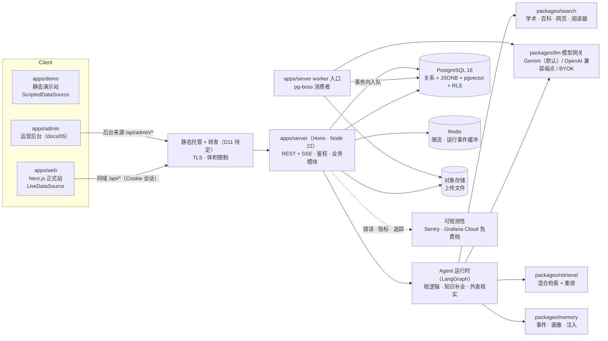
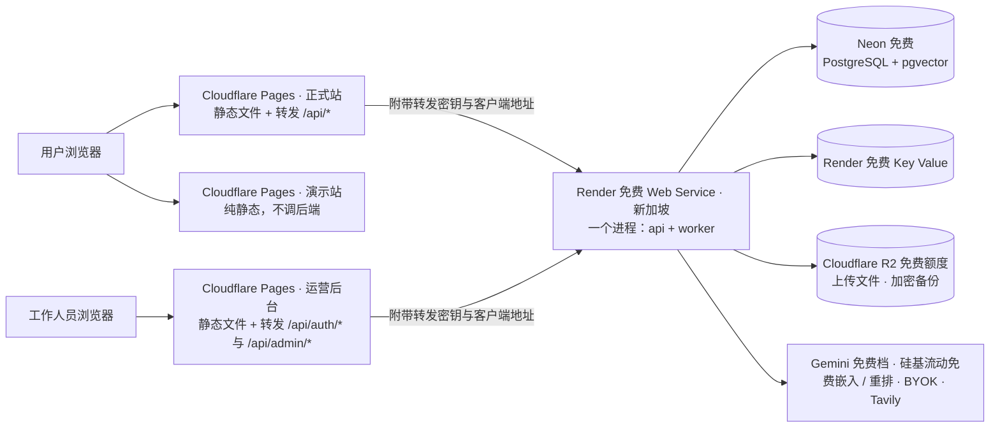

# 02 · 目标架构（对标商业化产品）

> 本文回答需求清单 B3、E1–E6、D1、D4：成熟商业化产品应包含哪些部分；前后端与数据库怎么配；用户系统怎么设计、哪些信息保密与隔离；对话与记忆怎么存、用什么格式；要重点处理哪些边界情况。
> 两个 Agent 的策略与实现见 [03-Agent策略设计](03-Agent策略设计.md)；执行顺序见 [04-执行计划](04-执行计划.md)。

## 0. 商业化产品应包含的部分（总览）

| # | 部分 | 本项目的落点 | 章节 |
|---|---|---|---|
| 1 | 客户端 | 正式站 `apps/web`、演示站 `apps/demo`，共用 `packages/ui`（demo 5 原界面） | §1、§2 |
| 2 | 接入层 | 反向代理 / CDN、TLS、同域路由 `/api → server`、请求体大小限制、限流 | §2 |
| 3 | 应用服务 | `apps/server`：REST + SSE、鉴权、业务模块、Agent 运行时 | §2 |
| 4 | Agent 运行时 | LangGraph 状态机、工具、模型网关、流式事件、取消、断点续跑、人类介入 | §2、docs/03 |
| 5 | 异步任务 | 摄取（解析 → 切块 → 嵌入 → 标注）、记忆巩固、预生成、定时清理、账号删除 | §2 |
| 6 | 数据层 | PostgreSQL（关系 + JSONB + pgvector + 行级安全）、对象存储、Redis | §3、§5 |
| 7 | 用户系统 | 注册登录、会话、权限、配额与套餐、BYOK、账号生命周期 | §4 |
| 8 | 安全与隐私 | 数据分级、加密、全链路隔离、审计、提示注入防护、合规 | §4 |
| 9 | 可观测性 | 错误追踪、结构化日志、指标、链路追踪、Agent 运行追踪、可用性探测、告警（零成本落点） | docs/05 §7 |
| 10 | 质量保障 | 单元 / 集成（真实 Postgres）/ E2E / 视觉回归 / Agent 评测 | docs/04 |
| 11 | 交付 | CI/CD、local / preview / production 三个环境、可审阅迁移、每日加密备份与每月恢复演练、回滚、版本错配处理；部署拓扑 | §8、docs/05 §8–§9 |
| 12 | 运营后台 | 平台运营后台（内部）：用户、用量与成本、Agent 运行、运行时开关、任务与邮件、审计、支持访问授权、工作人员与权限；默认看不到用户内容 | docs/05 §2–§6 |
| 13 | 成本控制 | 按角色路由模型、缓存、单次运行预算、用户配额、预算告警 | §4.5 |
| 14 | 控制面 | 身份与权限（含工作人员角色与两步验证）、配置（环境变量 + 入库的模型注册表）、运行时开关（熔断、灰度） | §9、docs/05 §4–§5 |

---

## 1. 界面统一方案（决策 D1）

### 1.1 三个选项对比

| 维度 | 方案一：全部统一为 demo 界面（只有一个真实站） | 方案二：demo 单独抽离 + 真实站用另一套 UI（或 Agent 原界面） | **推荐：同一套 demo 界面 + 两种数据源，两个站分开部署** |
|---|---|---|---|
| 保持原界面 | 是 | 演示站是；真实站否 | 是（两个站都是同一份界面代码） |
| 真实测试的是不是“你的产品交互” | 是 | **否**：Agent 原界面没有澄清选项、连线色调、逐跳延伸、三档粒度、收束报告——测的是另一个产品 | 是 |
| 演示稳定性 | 差：演示依赖模型与网络，剧本里精心编排的过程无法稳定复现 | 好 | 好：演示站完全不连后端 |
| 长期维护 | 一套 | **两套界面长期分叉**（这正是现在混乱的根源） | 一套界面，两种数据源实现 |
| 上线风险 | 演示与真实数据易混 | 低 | 低：两个站物理隔离 |

### 1.2 推荐方案的做法

- **界面只有一份**：demo 5 的组件与 CSS 原样迁入 `packages/ui`。
- **数据源接口**（`packages/data-source`）：把组件里写死的演示数据与 `fetch` 抽成一个接口 `MingxiDataSource`，组件通过 React Context 取用。
  - `ScriptedDataSource`（`packages/demo-data`）：演示剧本、银标笔记、录制资料，以及原版演示样例用到的本地确定性逻辑；**不发任何网络请求**。
  - `LiveDataSource`：调用 `apps/server` 的 HTTP / SSE 接口，返回同样形状的数据。
- **两个站**：
  - `apps/demo`：静态导出，可部署到 GitHub Pages / 任意 CDN；= 原版 demo 5 的体验。
  - `apps/web`：正式站，需要登录，所有数据真实；界面与演示站一致。
- **“样例会话 / 我的对话”的自然分工**：原界面的梳逻辑历史栏本来就分「样例会话」「我的对话」两段——正式站里样例会话保留为剧本回放（新手示例），我的对话全部走真实 Agent。知识扩展页的起点笔记列表在正式站展示用户自己的笔记。
- **Agent 的测试与调试**不另做产品界面：用 `evals/` 自动评测 + 后台的运行追踪页（后台属于运营工具，不是产品前端）。

### 1.3 数据源接口的边界（示意）

```ts
interface MingxiDataSource {
  library: { list(query): Promise<LibraryPage>; get(noteId): Promise<LibraryNote>; upload(files): Promise<IngestJob>;
             purposeLabels(): Promise<string[]>; savePurposeLabels(labels): Promise<void>;
             suggestPurpose(noteId): Promise<PurposeSuggestion>; confirmPurpose(noteId, label): Promise<LibraryNote> };
  logic:   { listSessions(); createSession(); submitTurn(sessionId, turn): Promise<LogicTurnResult>;
             getNoteCard(noteId): Promise<DemoNoteCard>; summarize(sessionId): Promise<ReportView> };
  knowledge: { listSeedNotes(query); openMap(seedNoteId, settings): Promise<SeedNote>; extendHop(mapId, depth);
               search(pointId, scope, query): Promise<SearchResult[]>; read(resultId); saveResult(pointId, resultId) };
  verify:  { start(noteId); search(...); complete(record) };
  profile: { summary(); rollback(traitId); confirm(traitId) };
}
```

返回类型**直接复用原组件里已有的类型**（`DemoNode`、`DemoEdge`、`ClarifyOption`、`DemoNoteCard`、`SeedNote`、`SearchResult`……），在 `packages/contracts` 里用 zod 定义成“唯一真相”，组件、数据源、服务端、Agent 共用。

### 1.4 允许对 UI 代码做的改动（穷举）

1. 改 import 路径；
2. 把组件内常量（如 `SEED_NOTES`、`DEMO_SESSION_PRESETS`）与 `fetch` 调用替换为 `useDataSource()` 的调用，渲染结果不变；
3. 原本用 `setTimeout` 模拟的等待（如“正在生成第 N 跳…”）改为等待数据源返回，期间显示的仍是原来那段文字；
4. 不改变外观的安全修复：链接 / 图片地址过滤 `javascript:` 等协议；`bodyHtml` 一律由服务端净化后下发。

除此之外的任何 UI 改动都必须先问用户。已确认的例外（docs/00 D5a–D5c）：演示站的自由输入在原有提示位置说明“请到正式站体验”；正式站只改清单里列出的几处“演示”字样且逐项截图确认；正式站新增一个沿用工作台风格的最小登录 / 注册页。

---

## 2. 前后端架构

### 2.1 总体结构



### 2.2 目录结构（monorepo）

```
mingxi_6.1/
├── apps/
│   ├── web/              正式站：Next.js 16 App Router；页面壳、登录/注册页、数据源注入
│   ├── demo/             演示站：Next.js 16 静态导出；同一套 packages/ui + ScriptedDataSource
│   ├── admin/            运营后台：Next.js 16 静态导出 + Tailwind；独立来源，只调 /api/auth/*、/api/admin/*（docs/05）
│   └── server/           Hono API + SSE + Agent 运行时；同一代码另有 worker 入口（异步任务）
├── packages/
│   ├── ui/               demo 5 原界面组件与 CSS（原样迁移）
│   ├── contracts/        zod 契约：DTO、SSE 事件、Agent 输入输出、画布与知识图形状
│   ├── data-source/      MingxiDataSource 接口 + LiveDataSource
│   ├── demo-data/        ScriptedDataSource：剧本、银标笔记、录制资料
│   ├── db/               Drizzle schema、可审阅的 SQL 迁移、RLS 策略、种子数据
│   ├── llm/              模型网关：供应商注册、按角色路由、结构化输出、重试、熔断、计量
│   ├── retrieval/        切块、中文分词、嵌入、混合检索（全文 + 向量 + RRF）、重排
│   ├── search/           联网搜索（多源、去重、可信度）、网页阅读（SSRF 防护）
│   ├── ingest/           解析 md/txt/html/pdf/docx/图片、领域标注、标签抽取
│   ├── memory/           记忆与画像：事件、特征、巩固、衰减、注入、回滚
│   ├── agent-logic/      梳逻辑 Agent
│   ├── agent-knowledge/  知识补全 Agent
│   ├── agent-verify/     外查核实 Agent
│   └── config/           共享 tsconfig / eslint / prettier
├── evals/                两个 Agent 的数据集、评测器、报告
├── e2e/                  Playwright：原版对比视觉回归 + 正式站与运营后台端到端
├── infra/                docker-compose（postgres+pgvector、redis、minio）、Dockerfile、部署清单
└── docs/
```

### 2.3 关键设计

- **前后端分离、同域部署**：浏览器只访问一个域名，网页与 `/api/*` 同源，会话 Cookie 为同站 `httpOnly; Secure; SameSite=Lax`，不需要跨域。零成本阶段由 `apps/server` 同一进程托管正式站静态产物；有预算后由 CDN / 反向代理按路径分流到独立服务（§8）。
- **Agent 运行与流式解耦**：发起一次 Agent 回合 = 创建一条 `agent_run`（立即返回 `runId`）；结果通过 `GET /api/runs/:runId/events`（SSE）推送，支持 `Last-Event-ID` 断线续传；`POST /api/runs/:runId/cancel` 取消。这样刷新页面、切网络、多标签页都不丢结果。`LiveDataSource` 对 UI 仍然暴露“一个 Promise 返回最终结果”，保持原交互。
- **长任务不放在请求里**：摄取、嵌入、记忆巩固、知识图预生成走 pg-boss 队列；入队与业务写入在同一个数据库事务里（不会出现“写了笔记但没入队”）。
- **业务接口默认要求登录**：除 `/api/health`、`/api/ready` 与认证路由 `/api/auth/*` 外，`/api/*` 一律依次经过：来源检查（写请求的 `Origin` 必须等于正式站来源，缺失也拒绝；SameSite=Lax 之外的第二道 CSRF 防线）→ 会话（无会话 401、账号冻结 403；会话滚动续期的新 Cookie 随响应写回）→ 按用户限流（默认 120 次 / 分钟，计数在 Redis）→ 幂等键 → 业务处理。新加的路由自动受这组中间件保护，不需要逐个记得加（`apps/server/src/app.ts`）。
- **幂等**：所有写接口接受 `Idempotency-Key` 头（8–128 个字母、数字或 `._:-`），同一用户同一个键 24 小时内只执行一次，重复提交返回第一次的状态码与正文并带 `Idempotent-Replayed: true`；第一次仍在处理时重复提交、或同一个键配了不同的请求（方法 / 路径 / 请求体不同）返回 409；第一次出现 5xx 不保存结果，可以用同一个键重试；“处理中”占位租期 5 分钟，进程中途崩溃也不会把键锁住一整天。键按用户隔离。保存的结果含响应正文，在 Redis 里停留 24 小时——Redis 不持久化、只在内网可达，这是用户内容（L3）在 Redis 里唯一的停留处。
- **客户端地址**：`X-Forwarded-For` 可以被客户端随意伪造，服务端用实际连接地址加上可信代理层数 `MINGXI_TRUSTED_PROXY_HOPS` 计算客户端地址（从链尾跳过这么多层代理），写进专用请求头交给认证模块；认证模块的限流与会话记录只读这个头（`apps/server/src/http/client-ip.ts`）。层数没有默认值，部署时必须按平台实际情况填写：填小了所有用户共用代理地址、一起被限流，填大了客户端可以伪造地址绕过限流。
- **配置**：所有环境变量启动时用 zod 校验，缺失即拒绝启动；三套环境 local / preview / production（docs/05 §9）。

### 2.4 客户端与服务端之间的约定

客户端（正式站、后台、以后的手机端）与服务端之间只通过下面这些约定交互，任何一边改实现都不影响另一边：

| 层次 | 约定 | 位置 |
|---|---|---|
| 界面 ↔ 数据 | 界面组件只调用数据源接口 `MingxiDataSource`，不知道 HTTP 的存在；正式站的 `LiveDataSource` 把接口调用翻译成 API 请求，演示站的 `ScriptedDataSource` 读剧本 | `packages/ui/src/data-source/port.ts` |
| 数据结构 | 请求与响应的结构用 zod 定义一份，服务端用它校验输入、客户端用它得到类型；接口文档由同一份定义生成 OpenAPI（P4 起） | `packages/contracts` |
| 传输 | 普通读写走 REST + JSON；Agent 回合先 `POST` 创建运行拿到 `runId`，结果通过 SSE 推送并支持 `Last-Event-ID` 断线续传；文件用预签名地址直传对象存储，不经过 API | §2.3 |
| 身份 | 浏览器只持有 `httpOnly` 的会话 Cookie，页面脚本拿不到任何令牌；写请求必须来自本站来源；会话续期的新 Cookie 随任意业务响应写回 | `apps/server/src/http/` |
| 错误 | 统一结构 `{ error: { code, message, requestId, details? } }`；客户端按 `code` 决定在原界面已有的哪个错误位置展示，`requestId` 用于反馈与排查 | `packages/contracts/src/errors.ts` |
| 重复提交 | 写请求带 `Idempotency-Key`，网络重试不会重复执行 | §2.3 |
| 限流 | 超限返回 429 与 `Retry-After`，客户端按秒数提示，不自动狂刷 | §2.3 |
| 版本 | 正式站与服务端同一次发布；服务端响应带 `X-Mingxi-Version`，打开着的旧页面发现版本不一致时提示刷新（EC-P9）。出现独立发布的原生客户端后，再引入 `/api/v1` 路径版本与弃用期 | docs/05 §9 |
| 缓存 | HTML 每次向服务器确认；带哈希的静态资源长期缓存；API 默认不缓存 | `apps/server/src/web/static-site.ts` |

---

## 3. 数据库配置

| 项 | 配置 | 理由 |
|---|---|---|
| 引擎 | PostgreSQL 16+ | 事务、JSONB、行级安全、生态成熟 |
| 扩展 | `vector`（pgvector ≥ 0.8，支持带过滤条件的迭代索引扫描）、`pg_trgm`、`citext` | 向量与业务同库；模糊匹配；大小写不敏感邮箱 |
| Schema 划分 | `auth`（账号会话）、`app`（笔记、对话、知识图）、`memory`（记忆画像）、`agent`（LangGraph 检查点）、`ops`（审计、用量、埋点）、`pgboss`（队列） | 权限与备份策略按 schema 区分 |
| 主键 | UUIDv7（应用生成，时间有序） | 索引局部性好、可排序、不暴露数量 |
| 时间 | `timestamptz`，存 UTC，展示按 `Asia/Shanghai` | 避免时区错乱 |
| 行级隔离 | 所有用户数据表启用 RLS：`user_id = current_setting('app.user_id')::uuid`；应用连接用无 `BYPASSRLS` 的角色；每个请求 / 任务在事务内 `SET LOCAL app.user_id` | 应用层过滤之外的第二道防线，写错一条 SQL 也不会串数据 |
| 账号与权限 | 两个数据库账号：表 owner（只用于迁移、建运行时账号）与运行时账号（`mingxi_runtime` 权限组成员，普通角色）。所有用户数据表 `FORCE ROW LEVEL SECURITY`，owner 也受约束；服务启动时检查运行时账号不是超级用户、不带 `BYPASSRLS`，否则拒绝启动。“只追加”的记录（消息、运行事件、记忆事件、画布版本）对运行时账号收回改 / 删权限，用量账目只能新增，审计日志只能写入 | 超级用户与 BYPASSRLS 角色会静默绕过行级隔离，必须从账号层面排除 |
| 跨用户一致性 | 子表带 `user_id`，用 `(父表 id, user_id)` 复合外键引用父表 | 数据库层面保证子行与父行属于同一用户，知道别人的 ID 也挂不上去 |
| 跨用户的维护任务 | 巡检卡住的运行、按保留期限清理等跨用户任务，届时（P5 / P8）新增不能登录的 `mingxi_maintenance` 权限组与只对它生效的策略（`TO mingxi_maintenance`），由后台任务的独立账号使用；运行时账号不是它的成员 | 不给任何账号 BYPASSRLS，权限按任务最小化 |
| 迁移 | drizzle-kit 生成 SQL → 人工审阅 → 提交 → 部署时执行；只前进；破坏性变更走“扩展 → 迁移数据 → 收缩”三步 | 可审计、零停机 |
| 连接 | 每进程 `pg.Pool`；生产经 PgBouncer（事务模式） | 控制连接数 |
| 备份 | 零成本阶段：每日 `pg_dump` 加密备份到对象存储、保留 30 天，每月在 CI 里恢复演练；叠加 Neon 免费档自带的 6 小时恢复窗口（详见 docs/05 §8）。有预算后改用付费档的时间点恢复 | 商业化底线；原写“时间点恢复保留 30 天”在免费档做不到，已修正（docs/06 #2） |
| 对象存储 | S3 兼容（本地 MinIO，线上 Cloudflare R2，见 §8）；私有桶；键 `u/{userId}/{noteId}/{fileId}`；预签名 URL 5 分钟有效；服务端加密 | 文件不进数据库，按用户前缀隔离 |
| Redis | 限流计数、运行事件缓冲（Redis Streams，TTL 1 小时）、幂等键、会话二级缓存 | 多实例共享状态 |

---

## 4. 用户系统

### 4.1 认证（Better Auth）

- **注册登录**：邮箱 + 密码（scrypt 哈希，8–128 位，内置常见弱密码表与重复字符、含邮箱用户名 / 昵称的拦截）、必须验证邮箱后才能登录、找回密码（重置后所有设备的会话失效）；第三方登录 GitHub / Google（配置了 ID 与密钥才启用，令牌加密存储）；按 D4 暂不做手机号短信登录（以后转国内云时再加）；可选 TOTP 二次验证。
- **不透露邮箱是否已注册**：用已注册的邮箱注册时，接口返回与正常注册相同的结果；“这个邮箱已注册，可以直接登录或找回密码”的提示通过邮件发给邮箱主人（同一邮箱一小时最多一封）。同一邮箱并发注册时由唯一约束兜底，后到的请求同样得到通用结果（EC-U1）。
- **邮件**：验证、找回密码、已注册提示先写入 `ops.email_outbox`，由 worker 认领投递（多进程不重复、崩溃后租约到期重新认领、失败按 30 秒起 4 倍退避、最多 5 次）；发送成功或放弃后清除正文里的一次性链接。投递走 SMTP，任意服务商可用（决策 D10）；本地开发可显式设置 `MAIL_TRANSPORT=log` 把邮件写进本机日志，生产环境拒绝。
- **会话**：数据库会话，Cookie 只存会话标识；7 天滚动续期；修改密码 / 邮箱、删除账号、导出数据等敏感操作要求近 10 分钟内重新验证；设备列表与“退出所有设备”。
- **防滥用**：按客户端 IP（服务端按可信代理层数计算，见 §2.3，伪造 `X-Forwarded-For` 无效）与接口限流，计数在 Redis（Lua 脚本原子计数，多实例共享）：登录 5 次 / 分钟、注册 10 次 / 小时、发验证邮件与找回密码 3 次 / 5 分钟、重置 / 修改密码 5 次 / 5 分钟，其余认证接口 100 次 / 分钟；可选人机验证。

### 4.2 授权

- 每条业务数据都有 `user_id`；服务层所有查询带 `user_id`，数据库 RLS 兜底。
- 角色：`user`、`admin`、`support`。后台默认**只能看聚合数据**，看不到任何用户的笔记正文、对话、画像；确需查看（如用户报障）要用户在设置里生成一次性授权码，且每次访问写入审计日志。
- 预留 `workspace`（团队空间）字段：当前每个用户一个个人空间，以后扩展协作时不改表结构。

### 4.3 数据分级：哪些要保密、哪些要隔离

| 级别 | 内容 | 存储与保护 | 谁能访问 | 日志策略 |
|---|---|---|---|---|
| L4 机密 | 密码哈希、会话令牌（Cookie 里是用服务端密钥签名的令牌，只拿到数据库内容无法伪造有效 Cookie）、OAuth 令牌（加密存储）、用户 BYOK 模型密钥、平台密钥 | BYOK 密钥用 AES-256-GCM 信封加密（每行数据密钥，由主密钥包裹；主密钥只在环境变量 / KMS）；平台密钥只在环境变量 | 只有服务端在调用时解密；**永不回传前端**（界面只显示末 4 位） | 永不记录 |
| L3 用户私有内容 | 笔记、片段、嵌入向量、上传文件、对话、逻辑画布、知识图、外查记录、记忆事件、画像特征 | 数据库与对象存储加密存储；RLS；按用户前缀 | 仅本人；Agent 只能在本人的请求上下文里读取 | 日志与追踪里**脱敏**（只记长度、ID、哈希） |
| L2 个人信息 | 邮箱、手机号、IP、设备信息 | 最小化收集；分析用 IP 做哈希 | 本人；后台看脱敏版 | 保留 180 天（满足日志留存要求后清理） |
| L1 运营聚合 | 活跃数、功能使用次数、失败率、成本 | 聚合后存 `ops` | 后台 | — |
| L0 公开 | 演示站剧本与银标示范数据 | 仓库内 | 所有人 | — |

### 4.4 全链路隔离点（每一处都要有测试）

1. 数据库查询：服务层 `user_id` 条件 + RLS；
2. 向量检索：`WHERE user_id = $1` 与向量排序同一条 SQL，启用 pgvector 迭代扫描，保证过滤后召回不缩水；
3. 模型上下文：一次 Agent 运行只装载当前用户的数据；
4. LangGraph 线程：`thread_id` 与会话表绑定，读写前校验归属；
5. 记忆命名空间：画像只按 `user_id` 读取，演示 / 示范数据产生的事件不入库；
6. 缓存键：一律带 `userId` 前缀；
7. 异步任务：负载带 `userId`，执行时重新校验归属与账号状态；
8. 对象存储：用户前缀 + 短时效预签名；
9. SSE：订阅运行事件前校验 `run.user_id`；
10. 日志 / 追踪：正文脱敏；Langfuse 等外部追踪开启内容遮罩。请求日志只记方法、路径（找回密码链接路径里的一次性令牌隐去）、状态码、耗时与 `userId`，不记查询串、请求头与请求体；结构化字段里的密码、令牌、密钥、正文类字段统一替换（`apps/server/src/logger.ts`）；
11. 联网搜索：**只把概念词发给第三方搜索**，不发送笔记原文；界面上的「联网搜索」开关即用户授权；
12. 导出 / 删除：只作用于本人数据，且需重新验证。

### 4.5 配额、套餐与 BYOK

- `plans`（免费 / 专业）定义每月模型 token、Agent 回合数、联网搜索次数、存储空间上限；`usage_ledger` 逐笔记账（模型、输入 / 输出 token、费用估算、来源运行）。
- 单次 Agent 运行有硬上限（最大步数、最大 token、最长 120 秒），防止成本失控。
- BYOK：用户可填写自己的 OpenAI 兼容端点与密钥；使用 BYOK 时不扣平台额度但仍限流；BYOK 失效时**明确报错**，不悄悄切回平台密钥（除非用户在设置里允许）。

### 4.6 账号生命周期与合规

- 新用户引导：可一键“导入示范笔记”到自己的库（标记 `is_sample`，不参与画像学习，可一键删除）。
- 数据导出：笔记（Markdown）+ 对话 + 画布 + 知识图 + 画像（JSON）打包下载。
- 删除账号：立即冻结 → 30 天冷静期 → 后台任务按清单硬删除（业务表、向量、对象存储、LangGraph 检查点、记忆、会话），日志中的标识做假名化。
- 合规（D4 定为香港 / 海外云，暂不涉及 ICP 备案；若以后面向中国大陆公众在境内运营，需补齐下列事项）：隐私政策与用户协议、个人信息查询 / 更正 / 删除 / 导出、网络日志留存不少于 6 个月、ICP 备案、使用境外模型时的数据出境告知与单独同意、生成式人工智能服务相关备案 / 登记要求。

---

## 5. 对话存储与记忆存储

### 5.1 原则

- **产品数据与 Agent 运行状态分开存**：界面要展示的历史（消息、画布、知识图）存在业务表里，是唯一真相；LangGraph 的检查点只用于“断点续跑 / 等待用户回答澄清后继续”，可以清理而不影响历史。
- **关系型行 + JSONB 载荷 + pgvector**：结构稳定的字段做列（便于索引、约束、隔离），结构多变的内容（消息分段、画布节点）做带版本号的 JSONB，向量做 `vector(1024)` 列。
- **追加为主、可追溯**：消息只追加；画布用“操作日志 + 定期快照”；记忆用“事件 → 特征”，每条特征都能追溯到产生它的事件。

### 5.2 对话（梳逻辑会话、外查核实）

| 表 | 关键字段 | 格式说明 |
|---|---|---|
| `app.conversations` | `id`, `user_id`, `kind`（logic / verify）, `title`, `branch`, `canvas_title`, `status`, `summary jsonb`（滚动摘要，用于长对话压缩）, `current_revision`, `created_at`, `updated_at`, `archived_at` | 一行一个会话；`id` 同时作为 LangGraph `thread_id` |
| `app.messages` | `id`(UUIDv7), `conversation_id`, `user_id`, `seq`, `role`（user / assistant / thinking）, `parts jsonb`, `status`（complete / error / cancelled）, `run_id`, `created_at` | `parts` 为带版本号的分段数组：`{v:1, parts:[{type:"text",text}, {type:"clarify_options",options:[{id,level,label,desc}],picked:[]}, {type:"cite",noteId,chunkId}]}`——消息里本来就有结构化元素（澄清选项、引用），所以不存成纯文本 |
| `app.canvas_revisions` | `conversation_id`, `revision`, `nodes jsonb`, `edges jsonb`, `positions jsonb`, `created_by`（agent / human）, `run_id`, `created_at` | 每次 Agent 生成或人工编辑后一个版本；`(conversation_id, revision)` 唯一，写入时做版本号比对（防并发覆盖） |
| `app.canvas_ops` | `conversation_id`, `revision`, `actor`, `op jsonb`（move / rename / lock / add_edge / hide…）, `seen_by_agent bool` | 人工操作日志；下一轮 Agent 读取“未感知的人工编辑”并把它们当约束 |
| `agent.checkpoints*` | LangGraph `PostgresSaver` 自带表 | 运行状态；每个线程保留最近 20 个检查点 |
| `app.agent_runs` | `id`, `user_id`, `conversation_id` / `map_id`, `agent`, `status`（queued / running / interrupted / succeeded / failed / cancelled）, `input jsonb`, `output jsonb`, `error jsonb`, `model`, `tokens_in`, `tokens_out`, `cost`, `started_at`, `finished_at` | 每次 Agent 回合一行 |
| `app.agent_run_events` | `run_id`, `seq`, `type`, `payload jsonb`, `at` | 步骤事件（检索命中、范式选择、补丁、校验结果），用于 SSE 续传、Thinking 内容与审计；保留 90 天 |

一致性：Agent 回合结束时，**同一个事务**写入助手消息、新画布版本、运行状态；进程崩溃时由巡检任务把超时运行标记为失败，会话保持一致（半截结果只留在运行事件里，不进入消息表）。

### 5.3 笔记与知识图

| 表 | 关键字段 |
|---|---|
| `app.workspaces` | `id`, `user_id`, `kind`（personal）, `name`——每个用户一个个人空间，内容表都带 `workspace_id`，以后加团队空间不改表结构 |
| `app.notes` | `id`, `user_id`, `workspace_id`, `title`, `summary`（界面卡片摘要）, `body_md`, `body_html`（服务端净化）, `source_kind`（library / web）, `modality`, `source_uri`, `source_title`, `captured_at`, `purpose_label`, `purpose_state`（declared / confirmed_ai / pending）, `domain_path text[]`, `theme`, `polarity`, `stance`, `functional_types text[]`, `user_goals text[]`（界面的 userGoals）, `tags text[]`, `content_hash`, `origin`（upload / capture / evidence_saved / verify / sample）, `is_sample`（由 origin 生成的列）, `origin_ref` |
| `app.note_chunks` | `id`, `note_id`, `user_id`, `ord`, `heading_path`, `text`, `tokens tsvector`（应用层中文分词后 `simple` 配置）, `embedding vector(1024)`, `embedding_model` |
| `app.note_files` | `note_id`, `user_id`, `object_key`, `mime`, `bytes`, `sha256` |
| `app.purpose_labels` | `user_id`, `label`, `ord`（用户自定义用途标签与排序） |
| `app.knowledge_maps` | `id`, `user_id`, `seed_note_id`, `goal`, `max_depth_generated`, `status`, `created_at` |
| `app.knowledge_branches` | `id`, `map_id`, `title`, `lens`, `library_source`, `ord` |
| `app.knowledge_points` | `id`, `map_id`, `branch_id`, `depth`(1–6), `labels jsonb {theme, concept, atomic}`, `summary`, `relation`, `coverage`（covered / partial / missing）, `evidence jsonb`（命中的本库片段 ID 与摘录）, `search_terms text[]` |
| `app.point_searches` | `point_id`, `query`, `scope`, `results jsonb`, `provider_status jsonb`, `created_at`（缓存 30 天） |
| `app.verification_records` | `id`, `user_id`, `note_id`, `question`, `verdict`, `conclusion`, `evidence jsonb`, `append_to_note`, `verified_at` |

### 5.4 记忆与画像（详细策略见 docs/03 §4）

| 层 | 表 / 位置 | 格式 |
|---|---|---|
| 工作记忆（本次对话） | LangGraph 状态 + `conversations.summary` | 状态对象；长对话超过预算时把早期轮次压缩为摘要 |
| 情景记忆（发生过什么） | `memory.events` | `id`, `user_id`, `occurred_at`, `source`（logic / knowledge / library / verify / profile）, `type`（如 `clarify_option_picked`、`followup_asked`、`node_renamed`、`node_locked`、`report_requested`、`hop_extended`、`gap_searched`、`evidence_saved`、`purpose_declared`、`trait_rolled_back`）, `subject_ref`, `payload jsonb`, `weight`；只追加，按 `(user_id, occurred_at)` 索引 |
| 语义 / 程序性记忆（它学到的我） | `memory.traits` | `id`, `user_id`, `dimension`（知识兴趣 / 知识水平 / 逻辑范式 / 切入点 / 深挖方式 / 深挖方向 / 视角 / 粒度 / 来源信任 / 呈现偏好）, `key`, `statement`, `scope jsonb`（全局 / 某用途 / 某领域前缀）, `polarity`（偏好 / 回避）, `weight`, `confidence`, `status`（proposed / active / rolled_back / deleted）, `origin`（rule / reflection / explicit）, `half_life_days`, `last_reinforced_at`, `embedding vector(1024)`, `version` |
| 特征证据 | `memory.trait_evidence` | `trait_id`, `event_id`——每条特征都能回答“因为你之前……” |
| 否定约束 | `memory.trait_constraints` | `user_id`, `dimension`, `key`——回滚后不再学回来 |
| 知识状态 | `memory.user_concepts` | `user_id`, `concept`, `embedding`, `state`（unknown / seen / understood / applied）, `evidence_count`, `last_seen_at`——知识补全据此判断“你已经懂什么、缺什么” |

### 5.5 为什么这样选

- **不用 MongoDB 等文档库**：笔记、对话、画像之间有大量关联与隔离要求，需要事务与行级安全；JSONB 已经覆盖“结构多变”的部分。
- **不把一切都存在 LangGraph 检查点里**：检查点是运行时快照，格式随框架版本变化，不适合做产品历史、做查询、做导出；也不便按需清理。
- **不单独上向量数据库**：单个用户的片段在千到十万量级，pgvector 的 HNSW 足够；与业务同库才能在一条 SQL 里同时做用户隔离、用途 / 领域过滤与向量排序。检索被封装在 `packages/retrieval` 接口后面，规模上来后可替换。
- **记忆不用现成的通用记忆库**（如只存“事实句子”的方案）：明晰需要的是带维度、带作用域、可回滚、可解释的认知风格画像，通用方案控制不了这些。

### 5.6 保留期限

| 数据 | 保留 |
|---|---|
| 笔记、消息、画布、知识图、画像 | 直到用户删除 |
| 运行事件 | 90 天 |
| LangGraph 检查点 | 每线程最近 20 个；超过 30 天未活动的线程只留最后一个 |
| 原始记忆事件 | 365 天（之后只保留已巩固进特征的部分） |
| 搜索结果缓存 | 30 天 |
| 访问日志 | 180 天 |

---

## 6. 技术选型（选择 / 备选 / 依据）

| 模块 | 选择 | 主要备选 | 依据 |
|---|---|---|---|
| 语言 | TypeScript 全栈 | Python 后端（FastAPI + LangGraph） | 界面是 React/TS，契约（zod）可前后端共用一份；LangGraph.js 1.5 已具备所需能力（状态图、`interrupt` 人类介入、`Command` 恢复、`PostgresSaver` 检查点、带向量索引的 `PostgresStore`，已在 npm 包中核实）；单语言降低维护成本。Python 生态更大是它的优势，但跨语言要维护两份契约 |
| Monorepo | pnpm workspaces + Turborepo | npm workspaces、Nx | pnpm 杜绝幽灵依赖；Turborepo 增量构建与缓存；Nx 对本项目过重 |
| 前端框架 | Next.js 16（标准版） | 继续用 vinext、Vite SPA | 原组件就是 Next App Router 写的（`next/link`、`next/dynamic`）；vinext 0.0.x 为实验版本；标准 Next 同时支持静态导出（演示站）与独立服务输出（正式站）。构建器用 webpack 而非默认的 Turbopack：原版工作台样式第一行用 `@import` 引入远程字体样式表，Turbopack 会丢掉它（实测，见 apps/demo/BASELINE.md） |
| API 服务 | Hono（Node 22） | Next 路由处理器、Fastify、NestJS | Agent 回合是长任务与长连接，独立进程不受无服务器时限；Hono 基于 Web 标准、内置 SSE、zod-openapi 生成接口文档、类型安全的 RPC 客户端；NestJS 过重 |
| Agent 编排 | LangGraph.js | 自研循环、Vercel AI SDK Agent、Mastra、OpenAI Agents SDK | 两个 Agent 都是多步骤、有人类介入（澄清、确认）、需要断点续跑的状态机，正好对应 StateGraph + interrupt + checkpointer；AI SDK 偏流式 UI 与单 Agent 工具循环；Mastra 建立在 AI SDK 之上，记忆模型较固定；OpenAI Agents SDK 偏 OpenAI 生态 |
| 模型接入 | LangChain `ChatOpenAI`（OpenAI 兼容端点：DeepSeek / 硅基流动 / 通义 / Ollama）+ 可选 `ChatAnthropic`，统一封装在 `packages/llm` | 每个模块自己 `fetch` | 一处实现结构化输出（zod）、工具调用、重试、超时、熔断、计量、BYOK；按“角色”（规划 / 生成 / 抽取 / 评审）路由不同模型 |
| 契约校验 | zod 4 | TypeBox、io-ts | 一份定义同时得到 TS 类型、运行时校验、JSON Schema（给模型做结构化输出） |
| 数据库 | PostgreSQL 16 + pgvector + pg_trgm | MySQL、MongoDB、独立向量库 | 见 §5.5 |
| ORM | Drizzle | Prisma、Kysely | SQL 优先、支持 pgvector 类型与 RLS 策略声明、迁移是可审阅的 SQL |
| 鉴权 | Better Auth | Auth.js、Clerk、自研 | TS 原生、Drizzle 适配、数据库会话、邮箱 / OAuth / 手机号 / 二次验证插件、内置限流；Auth.js 已并入 Better Auth；Clerk 是境外托管服务 |
| 任务队列 | pg-boss | BullMQ | 与业务写入同事务入队，不丢任务；BullMQ 依赖 Redis 且不能事务入队 |
| 缓存 / 限流 / 流式缓冲 | Redis（Valkey） | 只用 Postgres | 多实例共享限流与断线续传缓冲；Postgres `NOTIFY` 有 8KB 载荷限制 |
| 对象存储 | S3 兼容 | 存数据库 | 大文件不进数据库；预签名直传 |
| 嵌入 | BAAI/bge-m3（1024 维）经硅基流动 | OpenAI text-embedding-3、Qwen3-Embedding | 中英文效果好、成本低；表中记录 `embedding_model`，可后台重建切换 |
| 重排 | BAAI/bge-reranker-v2-m3 经硅基流动 | 不重排、LLM 重排 | 片段级召回后精排，成本远低于 LLM 重排 |
| 中文全文检索 | Node 内置 `Intl.Segmenter` 分词 + PostgreSQL `simple` 配置的 tsvector | zhparser、pg_jieba 扩展 | 托管 Postgres 普遍不允许安装中文分词扩展；应用层分词可移植 |
| 联网搜索 | 可插拔：学术 OpenAlex / arXiv / Crossref（免费）、百科 Wikipedia 中英、通用网页用 Tavily、中文网页用博查（均为平台密钥，缺少密钥的来源明确显示“未配置”，不静默跳过） | 只用一家 | 演示的四个搜索范围（全部 / 学术 / 资料 / 中文）天然对应多源 |
| 网页阅读 | 自建抓取 + `@mozilla/readability`（SSRF 防护、大小与超时限制） | Jina Reader | 不把用户浏览行为交给第三方；可控 |
| HTML 净化 | 服务端 markdown-it + sanitize-html 白名单 | 前端净化 | 存储时即安全，任何客户端都拿到干净内容 |
| 可观测 | pino 结构化日志、OpenTelemetry、Langfuse（LLM 追踪，可自托管）、Sentry | 只打控制台 | 定位一次失败的 Agent 回合需要逐步骤的追踪 |
| 测试 | Vitest（单元 / 集成，真实 Postgres）、Playwright（E2E + 视觉回归）、自研评测运行器 | Jest、Cypress | Vitest 与 Vite 生态一致、快；Playwright 截图对比成熟 |
| 部署 | Docker 镜像（同一镜像按 `MINGXI_PROCESS_ROLES` 启用 api / worker / web）；当前零成本阶段：Render 免费 Web Service + Neon 免费版 + Render 免费 Key Value + Cloudflare R2 免费额度，见 §8 | Cloudflare Workers + D1、Render 全家（含 Render Postgres） | 用户要求零成本：Render 免费 Postgres 30 天后删除、Background Worker 无免费档，所以数据库用 Neon、后台任务与 API 同进程；Workers 的执行时长限制与 D1（SQLite，无 pgvector、无 RLS）不适合长时 Agent 回合 |

---

## 7. 边界情况清单（每条都要落到测试，编号供 docs/04 引用）

### 7.1 用户与会话
- **EC-U1** 同一邮箱并发注册 → 唯一约束兜底，只建一个账号；两个请求都得到通用结果，“已注册”提示通过邮件发给邮箱主人（不在接口里透露邮箱是否已注册）。
- **EC-U2** Agent 运行中会话过期 → 运行在服务端继续完成；重新登录后结果可见。
- **EC-U3** 多设备 / 多标签同时编辑同一画布 → 版本号比对，旧版本写入被拒，客户端拉取最新后重放人工操作。
- **EC-U4** 删除账号时仍有任务在跑 → 任务执行前检查账号状态，冻结账号的任务直接放弃。
- **EC-U5** BYOK 密钥失效 / 余额不足 / 模型名错误 → 明确错误码与提示，不静默切换。
- **EC-U6** 配额用尽 → 在原界面的错误位置提示，不截断正在进行的回合。

### 7.2 梳逻辑
- **EC-L1** 笔记库为空或少于 3 篇 → 告知并建议导入示范笔记或开启联网，不编造。
- **EC-L2** 意图过于模糊 → 澄清；**最多两轮**，之后按画像先验或默认值推进并说明假设。
- **EC-L3** 用户不选澄清选项、直接输入别的话 → 把新话当作新的意图信息重新诊断。
- **EC-L4** 选项互相矛盾（如同时选“时间演进”和“只要清单”）→ 指出冲突并让用户二选一。
- **EC-L5** 追问指代不清（“这个”“上面那条”）→ 用当前选中节点 / 最近新增节点做锚点；锚点不唯一时反问。
- **EC-L6** 图过大（> 40 节点）→ 自动折叠远端支线，并建议收束成报告。
- **EC-L7** 模型返回非法 JSON / 不存在的节点或笔记 ID → 有限次修复重试；仍失败则本回合失败并明确提示，不写入半成品。
- **EC-L8** 引用的笔记后来被删除 → 引用显示为“已删除”，不报错。
- **EC-L9** 用户要求改动已锁定的节点 → 先确认再改。
- **EC-L10** Agent 运行期间用户手动改了画布 → 基于最新版本合并，冲突时人工编辑优先。
- **EC-L11** 用户中途停止 → 取消运行，丢弃未提交的补丁，会话保持上一个一致版本。
- **EC-L12** 中英文混合笔记、只有图片的笔记（依赖 OCR 文本）。
- **EC-L13** 笔记正文里藏着指令（提示注入）→ 正文一律作为数据包裹，工具不接受来自正文的参数。

### 7.3 知识补全
- **EC-K1** 起点笔记过短（< 200 字）或过长（> 10 万字）→ 过短提示信息不足；过长先切块摘要。
- **EC-K2** 起点笔记不是知识类内容（日记、待办）→ 说明不适合并给出原因。
- **EC-K3** 分支之间重复 / 跳与跳之间绕回 → 去重（名称归一 + 向量相似度）与“必须比上一跳更远”的校验。
- **EC-K4** 跳数漂移到与起点无关的领域 → 每跳做与起点 + 目标的相关性校验。
- **EC-K5** 已到第 6 跳；收回再延伸 → 复用已生成结果，不重复计费。
- **EC-K6** 切换粒度必须即时 → 三档名称同时生成，切换不调模型。
- **EC-K7** 覆盖度误判（同名不同义）→ 检索命中后用模型逐条核验“是否真的在讲同一个知识点”。
- **EC-K8** 用户库变化（新增 / 删除笔记）→ 覆盖度按需重算。
- **EC-K9** 搜索源超时 / 限流 / 全部失败 → 按来源显示状态，部分结果照常展示，全部失败时明确提示。
- **EC-K10** 付费墙、无法抓取正文 → 只展示摘要并标注。
- **EC-K11** 重复保存同一来源 → 内容哈希去重。

### 7.4 记忆与画像
- **EC-M1** 冷启动没有画像 → 不注入、不猜。
- **EC-M2** 一次性行为不应成为偏好 → 阈值 + 一致性要求 + 时间衰减。
- **EC-M3** 偏好随时间变化 → 半衰期衰减，新的明确选择压过旧的隐式信号。
- **EC-M4** 互相冲突的特征 → 按作用域分开（如“对标拆解类笔记”与全局），同一作用域内取证据更强者并降低置信度。
- **EC-M5** 敏感推断 → 禁止推断健康、政治、宗教、性取向等敏感属性（维度白名单）。
- **EC-M6** 用户回滚 → 写否定约束；用户删除 → 连同证据关联一起删除。
- **EC-M7** 示范笔记、演示剧本产生的行为 → 不进入画像。
- **EC-M8** 画像注入要可解释 → 使用处能说明“因为你之前……”。

### 7.5 摄取
- **EC-I1** 不支持的类型、超大文件（单文件上限 50MB、单次 200 个）、压缩炸弹 → 拒绝并说明。
- **EC-I2** 扫描版 PDF → OCR；GBK 等编码 → 自动识别转码。
- **EC-I3** 重复上传 → 内容哈希去重。
- **EC-I4** 恶意 HTML / Markdown → 服务端净化；图片去除 EXIF 位置信息。
- **EC-I5** 批量上传部分失败 → 逐文件状态，失败可重试，不影响已成功的。

### 7.6 平台
- **EC-P1** 模型供应商故障 → 熔断、明确报错、可配置备用模型（需用户允许）。
- **EC-P2** 单次运行成本失控 → 步数 / token / 时长硬上限。
- **EC-P3** SSE 断线 → `Last-Event-ID` 续传；运行已结束则直接返回结果。
- **EC-P4** 多实例部署 → 限流、事件缓冲、幂等键都在共享存储中。
- **EC-P5** 迁移期间新旧版本共存 → 扩展 → 迁移 → 收缩。
- **EC-P6** 时区、日期显示一致（原界面只显示日期段，避免 SSR 时区差）。
- **EC-P7** 大笔记库分页（> 1 万篇）。
- **EC-P8** 备份可恢复（每月演练）。
- **EC-P9** 发布后用户仍开着旧页面 → 响应头 `X-Mingxi-Version` 与页面版本不一致时提示刷新；接口在一个发布周期内保持向后兼容。
- **EC-P10** Redis 免费档只有约 25 MB → 只放可丢失的数据并逐项设上限（限流计数带过期、幂等结果只保存小于 64 KB 的正文、事件缓冲 1 小时过期）；就绪检查与指标上报 Redis 内存占用，超过 80% 告警。
- **EC-P11** 免费额度耗尽（Render 带宽与运行时长、Neon 计算时长、模型与搜索调用、邮件）→ 每日汇总统计各项用量，超过 80% 给管理员发邮件；耗尽时对应功能明确报错，不静默失败。
- **EC-P12** 有人绕过 Cloudflare Pages 直接请求 Render 的地址 → 没有正确的转发密钥一律 403，伪造的客户端地址头不会被采信（§8.2）。

---

## 8. 部署拓扑（D4：海外云 + 平台密钥；当前阶段零成本）

### 8.1 原则

- **每件事只有一个负责者**：跑服务、存关系数据、存文件、存临时数据各由一家负责，不重叠。旧项目混乱的根源是同一件事有好几套做法（后端同时有 Next 路由 / vinext / Cloudflare Worker，存储同时有 Postgres / D1 / JSON 文件 / 浏览器），而不是用了几个供应商。
- **代码只依赖标准协议**：PostgreSQL 连接串、S3 接口、Redis 协议、Docker 镜像、HTTP。换托管平台只改环境变量，不改代码。不使用任何平台专有接口（如 Workers 绑定、D1）。
- **进程角色可配置**：同一个 `apps/server` 镜像通过 `MINGXI_PROCESS_ROLES` 决定在本进程里启用哪些角色：`api`（HTTP + SSE）、`worker`（pg-boss 消费者）、`web`（托管正式站静态产物）。免费阶段三者合一；有预算后拆成多个服务，代码不变。

### 8.2 当前阶段：零成本拓扑（用户确认：没有预算，只用免费额度；静态站托管按 D11 调整）

> **D11（2026-10-19 用户确认）**：Render 自 2026-08-01 起免费工作区带宽只有约 5 GB / 月，并由同一工作区的全部服务共享，没有绑卡时超出即暂停全部免费服务到月底（来源见 docs/05 文末）。实测（未压缩）正式站登录页首屏约 0.77 MB、演示站工作台首屏约 0.82 MB，演示站产物共 22 MB（录制数据 11 MB、笔记库数据 4.2 MB，走导览时按需加载）——静态文件放在 Render 上几千次访问就可能用完额度。因此静态站全部放到 Cloudflare Pages（静态文件不限带宽），Render 只承担 API 与后台任务的流量。

| 用途 | 方案 | 限制与代价 |
|---|---|---|
| 静态站：正式站、演示站、运营后台 | Cloudflare Pages 免费档，三个独立项目（三个独立来源，Cookie 天然隔离）；静态文件不限带宽 | 免费档每月 500 次构建、每站最多 2 万个文件 |
| 同源转发 | 正式站与后台的 Pages 项目各带一个 Pages Function：正式站只转发 `/api/*`，后台只转发 `/api/auth/*` 与 `/api/admin/*`，目标是 Render 上的服务；浏览器看到的始终是 Pages 的来源，网页与接口同源，不需要跨域 Cookie | 与 Workers 共用免费额度：每天 10 万次请求、每次 10 ms CPU（转发几乎不占 CPU）；SSE 长连接经转发的表现在 P4 实测 |
| API + 后台任务 | **一个** Render 免费 Web Service（新加坡区），`MINGXI_PROCESS_ROLES=api,worker`；`web` 角色保留给本地与 CI 端到端测试、以及以后自托管时使用 | 带宽额度只剩 API 流量消耗；15 分钟无访问会休眠，再次访问冷启动约 1 分钟；休眠期间后台任务暂停，唤醒后从队列继续（pg-boss 任务持久化在 Postgres，不丢）。**不做定时 ping 保活** |
| PostgreSQL | Neon 免费版（新加坡区），启用 `vector`、`pg_trgm`、`citext` | 存储约 0.5 GB；空闲自动挂起，首个查询有短暂唤醒延迟；恢复窗口 6 小时，备份方案见 docs/05 §8。Render 免费 Postgres 30 天后删除，不可用 |
| Redis | Render 免费 Key Value（同区内网） | 约 25 MB、无持久化：只放限流计数、运行事件缓冲、幂等键这类可丢失的数据，逐项设上限（EC-P10） |
| 用户上传文件、加密备份 | Cloudflare R2 免费额度（约 10 GB 存储、出口流量免费） | 开通 R2 可能需要绑定付款方式（免费额度内不扣费）；若无法绑卡见决策 D7 |
| 模型 | 对话与结构化输出：默认 Gemini 免费档（用户已提供 Key，实测严格 JSON Schema 可用，见 §9）；嵌入 / 重排：硅基流动免费模型（BAAI/bge-m3、BAAI/bge-reranker-v2-m3）或 Gemini 嵌入，P4 评测后定；用户可填自己的 Key（BYOK） | 免费档有限流与 503 过载，网关退避重试并降级到备用模型；真实用户内容能否发给免费档见决策 D9；是否需要付费模型以评测结果决定（决策 D8） |
| 联网搜索 | OpenAlex、arXiv、Crossref、Wikipedia（免费免密钥）+ Tavily 免费额度 | 博查需付费，暂不接入；中文网页范围先由 Tavily 中文查询 + 中文维基覆盖 |
| 邮件（注册验证、找回密码） | 任意 SMTP 服务商（决策 D10，推荐 Resend 免费档）；同时提供 GitHub / Google 登录 | 免费额度通常每天数百封，足够内测 |
| 域名 | 先用 `*.pages.dev` 子域名；Render 的 `onrender.com` 地址不对用户公开（见下方“只接受转发层的请求”） | 自有域名每年约十美元，可选 |



**只接受转发层的请求（P9 部署时实现，EC-P12）**：Render 的 `onrender.com` 地址本身是公开的，如果有人绕过 Pages 直接请求它，就能自己伪造客户端地址相关的请求头、绕过按地址的登录限流。因此：

1. Pages Function 转发时加上转发密钥头 `X-Mingxi-Edge-Secret`（密钥同时配置在 Cloudflare 与 Render 的环境变量里，可轮换），并把 Cloudflare 提供的真实客户端地址写入专用头 `X-Mingxi-Edge-Client-Ip`（覆盖客户端自带的同名头）。
2. 服务端配置了 `MINGXI_EDGE_SECRET` 时，除平台健康检查路径外，所有请求必须带正确的转发密钥，否则 403；客户端地址直接取转发层写入的专用头，不再按 `X-Forwarded-For` 跳数推算。
3. 没有配置转发密钥时（本地、CI、以后自托管），沿用 P3.3 已实现的“连接地址 + `MINGXI_TRUSTED_PROXY_HOPS`”。

为零成本阶段带来的设计约束（已纳入实现）：
1. 正式站 `apps/web` 必须能静态导出（`output: "export"`）。基准版本里 `app/mingxi/web/page.tsx` 的 `generateMetadata` 读取请求头拼分享图地址，静态导出不支持，改为构建时由环境变量 `MINGXI_PUBLIC_URL` 生成——只影响页面 `<head>` 里的分享元信息，不影响界面。
2. 所有后台任务必须可中断、可恢复（休眠即中断）。
3. 数据库空间有限：嵌入只存片段级 1024 维向量；运行事件、检查点、搜索缓存按 §5.6 定期清理。
4. 网页与接口分属两个平台但对浏览器同源：正式站、后台都通过 Pages Function 转发接口请求，服务端的来源检查与 Cookie 设置以 Pages 的来源为准（`MINGXI_PUBLIC_URL`；后台另配 `MINGXI_ADMIN_URL`）。

### 8.3 有预算后的扩容（只改配置）

把同一镜像拆成 `web`、`api`、`worker` 三个付费服务（去掉休眠、可横向扩展）；Neon 升级付费档（时间点恢复、更大空间）；需要时在前面加 Cloudflare DNS / CDN / WAF；模型切到 DeepSeek 等付费模型。

### 8.4 上线前必须逐项核实

2026-10-19 已通过联网检索复核了一部分（结果与来源记在 docs/05 文末，多为第三方汇总，官方页面在本会话的网络策略下无法直接打开）：Render 免费带宽降为约 5 GB / 月（影响拓扑，见上方提示与 D11）、Neon 免费恢复窗口 6 小时（影响备份，见 docs/05 §8）、Cloudflare Pages 静态文件不限带宽。**部署前仍须逐项按当时官方页面核实并记录**：Render 免费 Web Service 的休眠规则与每月时长、免费 Key Value 规格；Neon 免费版的存储与计算额度；R2 开通是否需要绑卡；硅基流动免费模型清单；智谱免费模型清单与调用限制；Tavily 免费额度；所选邮件服务的免费额度。

---

## 9. 配置与密钥管理（需求 E7、E8）

成熟项目的通行做法是把“配置”和“密钥”分开：配置进仓库、密钥不进仓库。

| 内容 | 放在哪里 | 是否入库 |
|---|---|---|
| 模型注册表：有哪些供应商（Gemini、DeepSeek、硅基流动、任意 OpenAI 兼容端点）、每个角色（规划 / 生成 / 评审 / 抽取 / 嵌入 / 重排）默认用哪个模型、能力（是否支持严格 JSON Schema、工具调用）、限额与超时、备用模型 | `packages/llm/src/models.config.ts`（带类型校验） | 是 |
| 每个环境选用哪套模型（例如 `MINGXI_MODEL_PROFILE=gemini-free`）与各类开关 | 环境变量，`.env.example` 逐项注释 | 示例入库，真实值不入库 |
| 平台密钥（`GEMINI_API_KEY`、`DEEPSEEK_API_KEY`、`SILICONFLOW_API_KEY`、`TAVILY_API_KEY`、数据库连接串、会话签名密钥、BYOK 加密主密钥） | 本地：`.env`（已被 .gitignore 忽略）；云端会话：环境设置里的 Network secrets / 环境变量；生产：Render 环境变量；CI：GitHub Actions Secrets | 否 |
| 用户自己的模型 Key（BYOK） | 数据库，AES-256-GCM 信封加密（§4.3 L4） | 否 |

机制：
1. **启动校验**：服务启动时用 zod 校验全部环境变量，并检查“当前模型配置所需的密钥都已提供”，缺什么直接报出变量名，拒绝启动（已在 P1 的 `apps/server/src/env.ts` 建立模式）。
2. **切换供应商只改配置**：代码只依赖“角色”，不写死模型名；换模型 = 改 `MINGXI_MODEL_PROFILE` 或注册表，不改业务代码。
3. **密钥扫描**：secretlint（`.secretlintrc.json`：官方推荐规则集 + Google API Key 的 `AIza…` 与新格式 `AQ.…`、OpenAI 兼容格式 `sk-…`、Tavily `tvly-…`）。提交前钩子扫描暂存文件，CI 扫描全部入库文件（`pnpm secrets:check`），命中即失败，输出里密钥一律打码。只放行本机回环地址上、密码以 `_local_only` / `_ci_only` 结尾的开发与 CI 数据库连接串；本地 pre-commit 同时强制 `pnpm verify`。
4. **日志脱敏**：密钥字段在日志中一律替换（§4.3）。
5. **泄露处置**：任何密钥一旦出现在聊天、日志或提交历史中，视为泄露，立即在供应商处吊销并重建。

Gemini 实测（2026-10-18，用户提供的 Key）：账号可用 Gemini 2.5–3.8 系列与 `gemini-embedding-001` / `gemini-embedding-2`；OpenAI 兼容接口 `https://generativelanguage.googleapis.com/v1beta/openai/` 可用，严格 JSON Schema 结构化输出正常（约 7 秒，含思考 token）；原生接口出现过 503“需求过高”。因此 Gemini 与 DeepSeek、硅基流动共用同一个 OpenAI 兼容网关实现，网关对 429 / 503 做指数退避重试并按配置降级到备用模型（如 flash-lite），并记录 429 错误体中的配额信息作为免费额度的实测依据。

