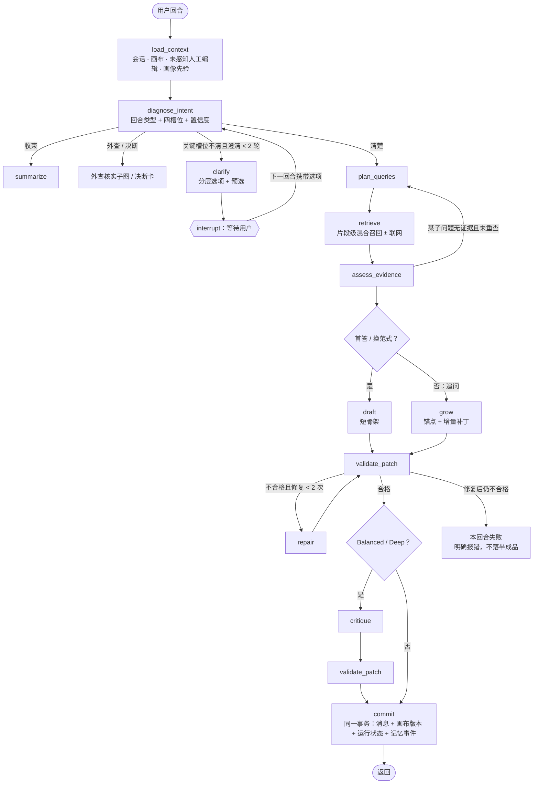
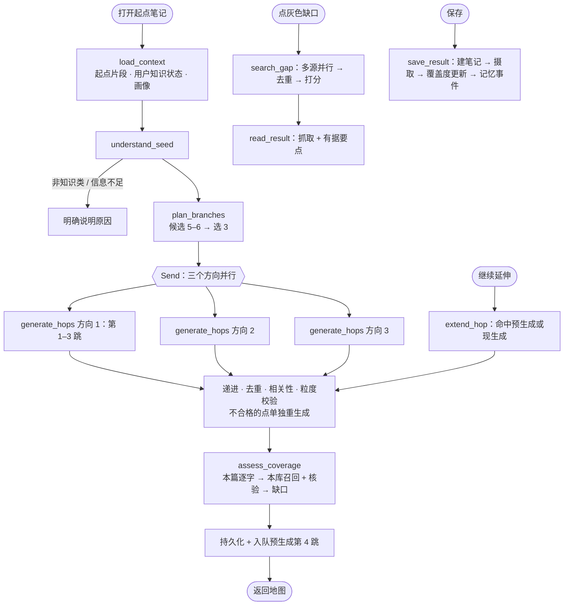
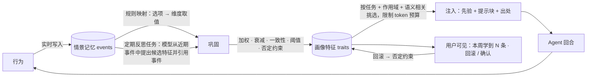

# 03 · Agent 策略设计

> 本文回答需求清单 C1–C4、D2–D4：先理清两个 Agent 的**产品策略**，再说明每条策略用到哪些 **Agent 技术点**、落在哪些**代码模块**、用什么**评测指标**验收。
> 策略的来源是 demo 5 本身：7 个梳逻辑演示剧本（`think-replay-*.ts`）、4 篇知识扩展起点（`KnowledgeExpansionDemo.tsx`）和 40 步导览里的产品旁白。这些剧本在新架构里有两个身份：演示站的数据，以及 Agent 评测的“目标形态”。

## 0. 策略和 prompt 的区别

旧实现的问题是把“策略”等同于“一段 prompt”。在新架构里：

- **策略** = 控制流（先做什么、什么时候停下来问人、什么时候重试）+ 数据（检索什么、记住什么）+ 约束（什么输出算合格）+ 记忆（按这个人调整）；
- **prompt** 只是控制流里某几个“需要模型判断”的节点的说明书，每个都有编号、版本、输入、输出 schema、少样本示例，可以单独评测；
- 每个 prompt 都登记在 `prompts/` 注册表里，并自动生成 `docs/prompts.md`，保证“prompt 里写了什么”永远可查。

---

## 1. Agent A · 梳逻辑

### 1.1 产品目标与亮点

**一句话**：用户带着一个困惑或目标，Agent 和他一起把库里零散的笔记长成一张**按他想要的逻辑方式组织的、每一步都能回到原笔记的有向逻辑图**；人主导方向，Agent 负责召回、组织、自检。

亮点（必须真实做到）：
1. **先澄清再动手**：意图不清时按“目标层 / 路径层 / 粒度层”给出可点选的选项，不替用户拍板；
2. **逻辑范式可选**：可执行落地、时间演进、因果机制闭环（负闭环 + 破局环）、对比辨析、证据强度分层、反例优先、问题驱动的学术表述、主题聚类、决策树分流；
3. **短图起步、追问生长**：首答故意很短，之后每次追问只在相关位置长出新分支或闭合回路，不推倒重来；
4. **片段级召回**：笔记主题不一样也能把正文里相关的段落找出来；
5. **每个判断可回链**：引用角标对应真实片段，并核验该片段确实支撑这个判断；
6. **人工编辑优先**：锁定的节点不动，局部重生成只改指定范围，人工改名 / 连线成为下一轮的约束；
7. **越用越懂**：常用的逻辑方式、切入点会成为默认选项。

### 1.2 策略 → 技术点 → 代码 → 评测

| # | 产品策略 | Agent 技术点 | 代码模块（`packages/agent-logic/src/…`） | 评测 |
|---|---|---|---|---|
| S1 | **意图诊断**：判断这一句是新问题、追问（补视角 / 问原因 / 质疑）、换逻辑方式、收束、外查、决断还是闲聊；抽取“目标 / 逻辑范式 / 粒度 / 主题范围”四个槽位及各自置信度 | 结构化输出分类 + 槽位填充（zod schema 约束），结合对话历史与当前画布 | `nodes/diagnose-intent.ts`、`prompts/diagnose.v1.ts` | 回合类型准确率；槽位 F1（标注集） |
| S2 | **反向澄清**：任一关键槽位置信度低、且画像先验也补不上时，给 2–3 层、每层 2–3 个选项；最多两轮，之后带着明说的假设继续 | 人类介入：LangGraph `interrupt()` 暂停，下一次用户回合携带选项用 `Command({ resume })` 继续；“问还是做”的阈值策略 | `nodes/clarify.ts`、`policy/ask-or-act.ts` | 该问时问的召回率、不该问时不问的精确率；平均澄清轮数 |
| S3 | **画像先验**：用户长期偏好的逻辑方式、切入点用来预选选项（界面已有的 `autoPick`），或在用户没说时补全槽位 | 长期记忆检索 + 先验注入（见 §3） | `nodes/load-context.ts`、`packages/memory` | 预选被用户保留的比例 |
| S4 | **检索规划**：按范式拆子问题（时间演进拆阶段、因果拆变量与机制、对比拆每一方），生成多条检索式；开启联网时只用概念词生成网页查询 | 查询分解、多查询改写、假设性答案扩展（HyDE） | `nodes/plan-queries.ts` | 子问题覆盖率（评审打分） |
| S5 | **片段级混合召回**：在用户全部笔记的片段上做全文 + 向量召回，倒数排名融合，交叉编码器重排，再做多样性筛选，避免全来自同一篇 | 混合 RAG（BM25 类全文 + 稠密向量 + RRF）、重排、MMR | `nodes/retrieve.ts` → `packages/retrieval` | 片段召回率 Recall@10（金标片段，如“短期记忆”剧本中埋在别的主题里的段落） |
| S6 | **证据评估与纠偏**：逐条判断召回片段与子问题是否相关；某个子问题没有证据就改写一次再查；仍没有就如实说明“库里没有”，可建议联网 | 纠偏式 RAG（检索结果自评 + 改写重查，至多一次） | `nodes/assess-evidence.ts` | 无证据时的如实率；改写后召回提升 |
| S7 | **范式技能库**：每种逻辑范式是一个“技能”：节点词汇（意图 / 主链 / 支线 / 笔记 / 终点 / 澄清 的徽标叫法）、骨架规则、生长规则、校验规则、少样本 | 程序性知识模块化（Skills 模式）；按范式切换 prompt 片段与校验器 | `paradigms/*.ts`（action-chain、timeline、causal-loop、contrast、evidence-tiers、objection-first、academic、topic-cluster、decision-tree） | 每种范式的校验通过率 |
| S8 | **短图起步**：会话首答或换范式时只生成 2–6 个节点的骨架，主链节点各挂 1–2 个笔记叶 | 先规划后执行（plan-and-execute）；输出预算约束 | `nodes/draft.ts` | 首答节点数 ≤ 6 的比例 |
| S9 | **追问生长**：定位追问对应的锚点节点（选中节点 / 最近新增 / 语义最近），只在锚点附近新增视角分支、补全机制齿轮、闭合负闭环、伸出警告支路或外侧破局环 | 指代消解与锚点定位；增量补丁生成（而非整图重生成） | `anchor.ts`、`nodes/grow.ts` | 补丁局部性（新增节点到锚点的距离）；与剧本目标形态的结构相似度 |
| S10 | **补丁校验与修复**：节点 / 笔记 / 片段 ID 必须真实存在；节点类型与连线色调合法；锁定节点字节级不变；局部重生成时范围外不变；范式规则（如负闭环必须真的成环、时间线不能倒序、可执行链以行动收尾）；不合格就带着错误清单让模型修，至多两次，仍失败则本回合失败 | 确定性护栏 + 修复循环 | `patch/ops.ts`、`patch/validate.ts`、`patch/apply.ts`、`patch/merge-human.ts` | 校验一次通过率；最终合格率 100%（不合格不落库） |
| S11 | **自检**：逐条检查“这条连线的判断是否被引用片段支撑”“有没有归错层”“有没有遗漏的反例”，给出修正补丁或标注 | 反思（reflection）+ 模型评审；仅在 Balanced / Deep 档启用 | `nodes/critique.ts` | 引用忠实度（评审 + 人工校准子集） |
| S12 | **人工编辑优先**：读取上一轮之后的人工操作（拖动、改名、锁定、补线、隐藏），作为本轮硬约束；Agent 运行期间若用户又改了画布，以最新版本合并、冲突时人工优先 | 操作日志 + 版本号比对的乐观并发 | `patch/merge-human.ts`、`app.canvas_ops` | 人工编辑保持率 100%（确定性测试） |
| S13 | **回答与引用**：回答正文用 `{{cite:noteId}}` 标注（界面已支持），只允许引用本轮证据池里的片段；同时给出 1–3 个可点的追问建议 | 受约束生成 + 引用白名单 | `answer.ts` | 非法引用数 = 0 |
| S14 | **收束报告**：用户主动要求时，把对话与画布收束为“要点 / 结构 / 证据 / 下一步” | 摘要生成（基于画布与引用） | 界面现有的报告抽屉在前端由画布生成；服务端提供 `summarize` 供“实机 Agent”界面与导出使用 | 评审打分 |
| S15 | **行为回写**：本回合的选项选择、追问类型、范式、被保留 / 被删的节点写成记忆事件 | 情景记忆写入 | `nodes/commit.ts` → `packages/memory` | 事件完整率 |

### 1.3 状态图

### 1.4 对接 demo 5 界面的输出契约

界面里已经定义好了 Agent 需要产出的形状，新 Agent 直接以它为契约（`packages/contracts/src/logic.ts`）：

- **节点** `DemoNode`：`kind ∈ { intent, spine, branch, note, action, gate }`；`badge`（范式相关叫法，如机制闭环里主链叫“机制”、支线叫“视角”、终点叫“破局”）；`label`、`sub`；笔记节点带 `noteId`；网页节点带 `sourceKind: "web"`、`sourceUrl`、`sourceTitle`、`sourceSummary`、`sourceTags`；
- **连线** `DemoEdge`：`label`；`tone ∈ { loop（负闭环回流）, break（破局）, warn（警告支路） }`；
- **对话**：`user` / `assistant` / `thinking` 三种条目；助手消息可带 `options: ClarifyOption[]`（`level` 分组）与 `autoPick`（画像预选）；正文引用 `{{cite:noteId}}`（ID 只允许小写字母、数字与连字符——界面的正则如此，笔记 ID 生成规则要满足它）；
- **会话元信息**：`branch`（当前分支一句话）、`canvasTitle`、`phase ∈ { clarify, draft, extend, final }`；
- **笔记卡片** `DemoNoteCard`：`bodyHtml`（服务端净化）、`fragments`（本回合命中的片段，界面会标黄）、`thumbLabel`、`thumbTone` 等由服务端从真实笔记生成。

“实机 Agent”界面（若 D2 保留）额外需要：`agentMode ∈ { agent, ask, plan }`（ask = 只召回回答不改图；plan = 只出角度与骨架预览不建链）、`thinkLevel ∈ { high-fast, balanced, deep }`（对应检索规模、是否自检、用哪个模型）、`lockedNodeIds`、`scopeNodeId`、待确认重排的“确认生效 / 放弃”、外查卡、决断卡。

---

## 2. Agent B · 知识补全

### 2.1 产品目标与亮点

**一句话**：从用户的一篇笔记出发，沿几个知识方向一跳一跳往外走，用户自己决定走多远（跳数）、看多细（粒度）；每个知识点都标明“本篇已提到 / 本库其他笔记有 / 知识库没覆盖”，只有缺口才联网补证，补到的资料保存后真的成为用户的笔记。

亮点：
1. 以用户**整个知识库**判断覆盖，而不只是这一篇；
2. 每一跳都“比上一跳更远”，且保留从起点到缺口的完整路径；
3. 同一个知识点三档名字（主题级 / 概念级 / 原子级命题），切换即时；
4. 缺口搜索按范围（全部 / 学术 / 资料 / 中文）多源并行，结果给出与这个缺口相关的要点；
5. 保存后覆盖度变化，形成“发现缺口 → 补上”的闭环，并反哺画像。

### 2.2 策略 → 技术点 → 代码 → 评测

| # | 产品策略 | Agent 技术点 | 代码模块（`packages/agent-knowledge/src/…`） | 评测 |
|---|---|---|---|---|
| K1 | **理解起点**：抽取起点笔记的核心论点与概念，每个都带逐字摘录；判断是否是适合扩展的知识类内容；过长先分块摘要 | 结构化抽取 + 逐字证据校验（摘录必须是原文子串） | `nodes/understand-seed.ts` | 逐字率 100%；非知识类识别准确率 |
| K2 | **规划知识方向**：生成 5–6 个候选方向（视角 / 透镜），按“与起点和目标的相关性 × 彼此差异 × 用户兴趣先验”选出 3 个；每个方向找出库里最相关的一篇笔记作为“本库关联笔记” | 候选生成 + 重排选择（嵌入相似度做多样性约束）+ 记忆先验 + 检索 | `nodes/plan-branches.ts` | 方向两两差异度；相关性评审 |
| K3 | **逐跳生成**：每个方向生成一条第 1–6 跳的链；第 d 跳必须在第 d−1 跳基础上更进一步（前提 → 机制 → 应用 → 影响 → 治理等），写明与上一跳的关系；跨方向去重、与起点保持相关 | 受约束的逐步扩展；多方向并行（LangGraph `Send` 扇出 / 汇合）；去重（名称归一 + 向量相似度）；递进与相关性校验 | `nodes/generate-hops.ts`、`checks/progression.ts`、`checks/dedupe.ts` | 递进性评审；重复率；漂移率 |
| K4 | **三档粒度命名**：每个知识点同时生成主题级、概念级、原子级（一个最小命题）三个名字和一句摘要；主题 ⊃ 概念 ⊃ 原子 | 多粒度结构化生成 + 一致性校验 | 同上，`checks/granularity.ts` | 粒度一致性评审 |
| K5 | **覆盖度判定**：先在起点笔记里找逐字证据（有 → 本篇已提到）；再在用户其他笔记的片段里混合召回，并用模型逐条核验“讲的是不是同一个知识点”（是 → 本库其他笔记，附出处）；否则为缺口 | 混合检索 + 判别式核验（避免同名不同义）+ 用户知识状态 | `nodes/assess-coverage.ts` → `packages/retrieval` | 覆盖度三分类准确率（金标） |
| K6 | **按需延伸与预生成**：打开时生成第 1–3 跳；后台预生成下一跳，使“继续延伸”与原交互一样即时；“收回一跳”不丢已生成内容 | 异步任务预取 + 缓存 | `nodes/extend-hop.ts`、worker 任务 `knowledge.prefetch` | 延伸等待时间 P95；重复计费 = 0 |
| K7 | **缺口补证**：用路径（知识点三档名 + 方向 + 起点领域）构造查询，学术源用英文改写；按范围并行检索、去重（DOI / 规范化 URL / 标题）、打分（与缺口的相关性重排 + 来源可信度 + 时效 + 跨源一致） | 多源工具调用、查询改写、重排、可信度建模 | `nodes/search-gap.ts` → `packages/search` | nDCG@5（评审）；各源成功率 |
| K8 | **阅读要点**：对候选结果抓取正文，抽取与这个缺口相关的 3 条要点（带原文摘录并校验） | 网页阅读 + 有据抽取 | `nodes/read-result.ts` | 要点有据率 |
| K9 | **保存闭环**：保存为明晰笔记（来源、摘录、要点），进入摄取管线（切块、嵌入、标注），该知识点覆盖度变为“已覆盖”；写入记忆事件，更新用户知识状态与兴趣 | 写回 + 情景记忆 | `nodes/save-result.ts` | 保存后覆盖度正确更新 |
| K10 | **个性化**：方向选择偏向用户常深入的视角；已掌握的概念不重复铺开；搜索范围默认顺序按来源偏好 | 记忆先验 | `nodes/load-context.ts` | 个性化开 / 关的离线对比 |

### 2.3 状态图

### 2.4 对接 demo 5 界面的输出契约

以 `KnowledgeExpansionDemo.tsx` 里的类型为契约：`SeedNote { id, kind, title, summary, domain, meta, branches[] }`；`KnowledgeBranch { id, title, librarySource, points[] }`；`KnowledgePoint { id, depth: 1–6, labels: { theme, concept, atomic }, summary, coverage }`；本库证据 `LocalEvidence { title, excerpt, source }`；搜索结果 `SearchResult { id, domain, path, title, snippet, date, type: academic | docs | chinese, tags, topics, readTime, keyPoints }`。界面里由模板拼出的假搜索结果，在正式站由 K7–K8 的真实结果替代。

---

## 3. 外查核实（笔记阅读页）

对应界面 `ExternalVerificationFlow`：定义问题 → 审阅证据（采纳 / 保留 / 排除）→ 形成结论（基本成立 / 部分成立 / 已经过时 / 不被支持 / 证据不足）→ 写回笔记或转成逻辑分支。

| 策略 | 技术点 | 代码 |
|---|---|---|
| 从笔记抽出可核实的主张，生成核实问题 | 主张抽取 | `packages/agent-verify/src/claims.ts` |
| 多源检索证据，标注每条证据对主张是支持 / 反驳 / 显示过时，及来源可靠度 | 工具调用 + 立场判别 | `evidence.ts` |
| 人审：采纳 / 保留 / 排除由用户决定，Agent 只给建议和理由 | 人类介入 | 界面已有 |
| 根据被采纳的证据给出结论建议与措辞，用户确认后写回 | 有据生成 | `conclude.ts` |

---

## 4. 记忆与画像：让 Agent 越用越懂用户

### 4.1 画像维度（回答“喜欢什么知识 / 什么逻辑方式 / 什么认知方式”）

| 归类 | 维度 `dimension` | 取值示例 | 主要信号来源 | 使用者 |
|---|---|---|---|---|
| 喜欢什么样的知识 | `knowledge_interest` | 开放词表：领域路径、主题（如“Agent 记忆架构”） | 笔记库构成、深入过的分支、保存的证据、追问主题 | 知识补全选方向；梳逻辑检索加权 |
| | `knowledge_level` | 某领域：入门 / 进阶 / 深入 | 用户知识状态表、追问的专业程度 | 知识补全跳过已掌握内容；回答深浅 |
| | `source_trust` | 官方 > 博客；偏好学术；中文 / 英文 | 搜索范围选择、采纳 / 排除的证据来源 | 搜索排序；外查核实 |
| 什么样的逻辑方式 | `logic_paradigm` | 可执行落地 / 时间演进 / 因果闭环 / 对比辨析 / 证据分层 / 反例优先 / 学术表述 / 主题聚类 / 决策树 | 澄清选项的选择、对某范式结果的保留或推翻、“换个角度”的请求 | 梳逻辑默认范式与预选 |
| | `granularity` | 主题级 / 概念级 / 原子级；短图 / 长图 | 粒度切换、首答后是否要求展开 | 两个 Agent |
| 什么样的认知方式 | `entry_point` | 定义先行 / 对比先行 / 反例先行 / 短三分法再生长 / 问题驱动 / 证据先行 | 每次追问的类型（由 S1 意图诊断顺带分类） | 梳逻辑首答形态 |
| | `deepen_logic` | 先广后深 / 层层递进 / 反例→正例 / 因果链 / 决策树分流 | 连续追问的模式 | 生长策略 |
| | `dig_direction` | 逼近决策 / 工程实现 / 理论机制 / 证据强度 / 差异边界 | 追问落点 | 生长方向 |
| | `perspective` | 产品 / 机制 / 评测 / 失败对照 / 时间演进 / 工程落地 / 路由选型（可扩展） | 追问视角 | 生长时优先补哪个视角 |
| 呈现偏好 | `presentation` | 卡片短一点、先结构后内容…… | 显式反馈、回滚 | 回答格式 |

认知风格四维（切入点 / 深挖方式 / 深挖方向 / 视角）沿用旧仓库 `question-style.ts` 的分类法，但抽取方式从正则换成意图诊断的结构化输出。**维度是白名单**：禁止推断健康、政治、宗教、性取向等敏感属性（EC-M5）。

### 4.2 学习闭环

1. **采集**（实时、只追加）：显式信号权重高（选项选择、用途声明、确认 / 回滚、粒度切换、搜索范围选择）；隐式信号权重低（追问类型、生成后被改名 / 删除 / 锁定的节点、是否要报告、延伸了几跳、保存了什么）。示范数据与演示剧本产生的行为不采集（EC-M7）。
2. **抽取**：
   - 规则映射：每类显式事件有确定的“维度 → 取值”映射（如选了“避雷前置” → `logic_paradigm = objection_first` +1）；
   - 意图诊断顺带输出本次追问的认知风格标签，写进事件；
   - 反思任务（异步，每个会话结束或每 20 条事件触发一次）：模型阅读近期事件，提出开放词表的候选特征（如兴趣主题），**必须引用事件 ID**，否则丢弃。
3. **巩固**：得分 = Σ 权重 × e^(−经过天数 / 半衰期)；同一作用域内一致性 ≥ 0.7 才算稳定；得分 ≥ 2 进入“提议”，≥ 3 自动生效；破坏性类别（删除、覆盖）永远需要用户确认（沿用 `learning.ts` 的护栏）；被回滚过的取值写入否定约束，不再学回来；冲突特征按作用域拆分（如“对标拆解类笔记”与全局分开）。
4. **注入**：`getUserContext({ userId, task, query, scope })` 只挑与本任务相关的维度（梳逻辑：逻辑方式与认知方式；知识补全：知识兴趣、知识水平、粒度、来源信任），兴趣类特征再按与当前问题的语义相关度排序，总量不超过约 300 token。用法有三种：① 结构化先验（默认范式、`autoPick` 预选、方向排序权重、搜索范围顺序）；② 提示中的“用户偏好（软约束，与用户当前明确要求冲突时以当前要求为准）”；③ 在运行事件里记下用了哪条特征，界面“本周学到 N 条”和回滚因此有据可查。
5. **用户可控**：界面已有“本周学到 N 条 · 回滚”。完整的“它学到的我”管理页（查看全部、确认、回滚、删除）属于新增界面，列为决策 **D6**，未确认前不做。
6. **效果评测**：离线用若干“有稳定偏好的模拟用户”跑多轮会话，个性化开 / 关对比：澄清轮数、预选保留率、生成后人工修改次数、范式命中率；线上按用户分组对比同样指标。

### 4.3 系统级进化（与个人画像分开）

个人画像只用本人数据。产品层面的改进来自**聚合且去内容化**的指标：每个 prompt 版本的校验失败率、修复次数、用户放弃 / 推翻率、各范式满意度。改进 prompt 或策略后先过 `evals/` 再发布（prompt 有版本号，可灰度）。

---

## 5. 模型分工（默认值，可在配置中替换）

| 角色 | 默认模型 | 用在 |
|---|---|---|
| 规划 / 诊断 | DeepSeek V3 系列（`deepseek-chat`，JSON 输出） | S1、S2、S4、K2 |
| 生成 | `deepseek-chat`；Deep 档用推理模型 | S8、S9、K3、K4 |
| 评审 / 核验 | `deepseek-chat`（温度 0） | S6、S11、K5、K8 |
| 轻量抽取 / 标注 | 硅基流动上的 Qwen 系列 | 摄取标注、反思任务 |
| 视觉 | 硅基流动上的 Qwen-VL 系列 | 图片笔记 OCR 与描述 |
| 嵌入 | BAAI/bge-m3 | 检索、去重、画像语义匹配 |
| 重排 | BAAI/bge-reranker-v2-m3 | S5、K5、K7 |

具体可用模型与区域、密钥策略取决于决策 D4。

---

## 6. 评测体系（`evals/`）

| 数据集 | 来源 | 用于 |
|---|---|---|
| 剧本目标形态 | 7 个梳逻辑剧本的用户发言序列 + 每步画布 | 用剧本发言驱动真实 Agent，评审结构相似度（范式、是否成环、分支语义）——剧本即“理想答案的形状” |
| 意图与澄清标注集 | 剧本发言 + 新增标注（清楚 / 模糊、范式、回合类型） | S1、S2 |
| 片段召回金标 | 60 篇银标笔记 + 金标片段 | S5、K5 |
| 知识扩展目标形态 | 4 篇起点笔记 × 3 方向 × 6 跳 | K2–K4 的结构与递进评审 |
| 覆盖度金标 | 银标库上人工标注的 covered / partial / missing | K5 |
| 模拟用户 | 若干有稳定偏好的人设脚本 | §4.2 第 6 点 |

确定性检查（逐字率、ID 合法、锁定不变、局部性）每次提交都跑；需要模型的评测在 CI 里用录制的模型响应回放跑冒烟，完整评测按需或每日跑并生成报告。
