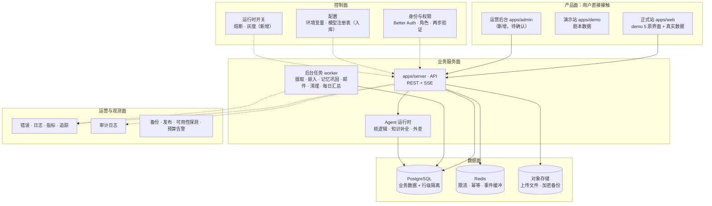
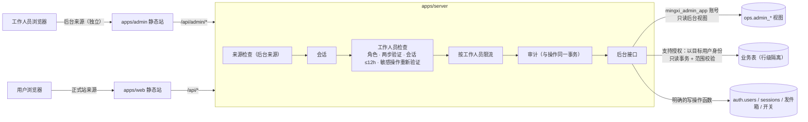

# 05 · 运营后台、可观测性与平台运维（对标成熟产品）

> 本文回答需求清单 G1–G4（M5）：有了用户系统之后，一个成熟产品还缺什么；要不要后台、后台怎么从零设计、和数据怎么联通；成熟企业级项目的后台长什么样；整个系统里客户端与服务端之间是什么结构。
> 整体前后端架构与客户端—服务端约定见 [02-目标架构](02-目标架构.md) §2；本轮自查发现的问题见 [06-自查与改进](06-自查与改进.md)。
> 决策 D11–D13 已于 2026-10-19 由用户确认（静态站放 Cloudflare Pages + 转发；后台自建、标准后台风格；客服只凭用户授权码查看内容）。

---

## 0. 先回答三个问题

**问 1：有了用户系统，还需要什么？**
用户系统只解决“谁在用”。一个能长期运营的产品还需要另外四类能力，缺任何一类都会在上线后出问题：

| 类别 | 解决什么 | 明晰现状 |
|---|---|---|
| 运营后台 | 团队自己怎么管理用户、处理求助、看产品跑得好不好、处理异常任务 | **缺失**，本文 §2–§6 从零设计 |
| 可观测性 | 出错时第一时间知道、能定位到哪一步 | 只有结构化日志；本文 §7 补全 |
| 控制面 | 不改代码就能临时关掉一个出故障的功能、切换备用模型、调整某个用户的额度 | 模型注册表已设计（docs/02 §9），运行时开关缺失；本文 §4 模块 6 |
| 平台运维 | 备份能恢复、发布能回滚、免费额度用完前有预警 | 备份方案在零成本条件下不成立（见 docs/06 #2）；本文 §8–§9 修正 |

**问 2：是不是需要后台管理界面和数据联通？要从 0 开始吗？**
需要，而且确实要从零设计。原因有两个：基准界面（demo 5）只有用户侧，没有任何后台；后台面对的是“跨用户”的数据，而我们的数据库按用户强制隔离（docs/02 §3），后台不能简单地“连上数据库看表”，必须专门设计它能看什么、不能看什么、怎么看。

**问 3：成熟企业级项目的后台是什么样？**
先分清两种“后台”，它们经常被混为一谈：

| | 平台运营后台（内部） | 企业租户管理台（外部） |
|---|---|---|
| 给谁用 | 我们自己的团队：运营、客服、工程 | 购买团队版的客户公司的管理员 |
| 管什么 | 所有用户的账号状态、额度、任务、成本、审计 | 本公司成员、单点登录、成员权限、账单 |
| 典型例子 | 各家 SaaS 的内部 Back Office / Admin Console | Notion、Slack、飞书的“企业管理后台” |
| 明晰现在需要吗 | **需要**（上线即需要：处理求助、冻结滥用账号、看成本） | 暂不需要；数据模型已预留 `workspace`（docs/02 §4.2），卖团队版时再做 |

成熟的平台运营后台有这些共同特征（§3 逐条落到明晰）：独立应用、强认证、按角色最小授权、每个操作留审计、默认看不到用户内容、指标来自汇总表而不是实时扫全库、运行时开关与熔断、监控交给专业工具而不是自己造。

---

## 1. 成熟产品的完整版图（五个平面）

把整个系统按职责分成五个平面，每个平面在明晰里都有明确的落点：

| 平面 | 组成 | 状态 |
|---|---|---|
| 产品面 | 正式站、演示站、运营后台；远期：手机端、浏览器插件 | 正式站登录页 ✅（待 D5c 确认）、演示站 ✅、后台 ➕ 本文 |
| 业务服务面 | API、Agent 运行时、后台任务 | API 骨架与鉴权 ✅；Agent 与任务按 P4–P8 |
| 数据面 | PostgreSQL、Redis、对象存储 | ✅ 表结构与隔离；对象存储随 P4 |
| 控制面 | 身份与权限、配置、运行时开关 | 身份 ✅；工作人员角色与两步验证 ➕ §5；运行时开关 ➕ §4 |
| 运营与观测面 | 错误、日志、指标、追踪、审计、备份、发布、探测、告警 | 日志 ✅、审计表 ✅；其余 ➕ §7–§9 |

---

## 2. 定位与范围

- **做的是平台运营后台**：给明晰团队内部使用，不对普通用户开放，也不从正式站的任何地方链接过去。
- **界面从零设计**：它不属于 demo 5 原界面，不受“前端不改”红线约束；但它是新增界面，按 D5c 的先例，**界面风格先给用户看截图确认（决策 D12）**。
- **不做“上帝视角”**：后台默认只能看账号元数据与聚合统计，看不到任何用户的笔记、对话、画布、画像（docs/02 §4.2 已定的原则）。客服确实需要看某条内容时，走 §6.3 的“支持访问授权”。

---

## 3. 设计原则（成熟后台的共同点 → 明晰的做法）

| # | 原则 | 明晰的做法 |
|---|---|---|
| 1 | 后台是独立应用 | `apps/admin` 单独构建、单独来源（origin）。浏览器按来源隔离 Cookie，正式站页面即使出现脚本注入，也拿不到后台会话；后台页面 `noindex`、不被搜索引擎收录 |
| 2 | 强认证 | 工作人员账号强制两步验证（TOTP + 一次性备用码，Better Auth `twoFactor` 插件）；后台会话最长 12 小时；冻结用户、调整额度、使用支持授权这类敏感操作要求 10 分钟内重新验证 |
| 3 | 最小授权 | 角色 → 权限矩阵（§5），每个接口声明自己需要的权限，中间件统一检查；默认拒绝 |
| 4 | 操作留痕 | 每个写操作必须填写原因，与操作本身在同一个事务里写入 `ops.audit_log`；查看敏感数据（支持授权、导出）同样记审计；审计只追加，后台自己也不能改删 |
| 5 | 不绕过数据隔离 | 后台的数据库账号不带 `BYPASSRLS`，只能读专门的“后台视图”（只含元数据与计数，不含正文列）；正文只能以目标用户身份、在授权范围内读取（§6.3） |
| 6 | 不提供“以用户身份登录” | 很多后台有“模拟登录”（impersonation），它等于让工作人员看到用户的全部内容。明晰不做；Better Auth `admin` 插件自带这个能力，因此不启用该插件，后台的用户管理接口自己实现 |
| 7 | 指标来自汇总表 | 每日汇总任务把指标写入 `ops.daily_metrics`，图表只读汇总表，不在请求里扫大表；按维度切分后不足 5 个用户的格子不显示，防止从统计里反推个人 |
| 8 | 配置走代码评审，开关走后台 | 模型注册表、套餐定义等配置在仓库里改（经过代码评审与 CI）；后台只提供有限的运行时开关（熔断、灰度比例），开关变更同样审计并可一键恢复默认 |
| 9 | 观测用现成工具，运营动作自己做 | 错误追踪、日志检索、指标图表用 Sentry、Grafana Cloud 的免费额度（§7）；用户管理、额度、任务、审计这些依赖我们的数据模型与隐私规则的，自己做 |

---

## 4. 模块设计

“MVP”是上线前必须有的；其余随对应的业务阶段落地（数据有了，后台页面才有意义）。

| # | 模块 | 主要功能 | 数据来源 | 所需权限 | 阶段 |
|---|---|---|---|---|---|
| 1 | 概览 | 新注册、完成验证、日活 / 周活、次日 / 7 日留存；Agent 回合数、成功率、平均耗时、失败原因 Top 5；当日模型成本；队列积压、失败任务、邮件投递失败；依赖健康 | `ops.daily_metrics`（每日汇总）+ 实时的就绪检查 | `metrics.read` | MVP（账号类指标）；Agent 与成本指标随 P5–P8 |
| 2 | 用户 | 按邮箱 / 用户 ID 精确查找；详情：注册时间、验证状态、账号状态、角色、套餐与本月用量、设备会话列表、该用户相关的审计时间线；操作：冻结 / 解冻、退出所有设备、重发验证邮件、发送重置密码邮件、标记测试账号 | `ops.admin_user_overview` 视图（auth.users + 会话数 + 用量汇总，不含正文） | 查看 `users.read`；操作见 §5 | MVP |
| 3 | 用量与成本 | 每日 / 每模型 / 每角色的 token 与费用；按用户排序的 Top 用量（只显示用户 ID 与打码邮箱）；免费额度剩余（模型、搜索、邮件）；预算阈值 | `ops.usage_ledger` 汇总、`ops.daily_metrics` | `usage.read`；调整阈值 `flags.write` | P4 起 |
| 4 | Agent 运行 | 运行列表：Agent、状态、耗时、步骤数、token、模型、错误码；单次运行的步骤时间线（每步类型、耗时、模型调用的元数据）；卡住的运行一键标记失败。**输入输出正文不显示**，需要时走支持授权 | `app.agent_runs` 的元数据列、`app.agent_run_events` 的类型与时间（不读 payload） | `runs.read` / `runs.manage` | P5 |
| 5 | 评测与模型 | 每次评测的分数趋势（梳逻辑 S1–S15、知识补全 K1–K10）；当前生效的模型配置（只读，来自仓库）；各供应商近 24 小时成功率与延迟 | `ops.eval_runs`（评测运行器写入）、`ops.daily_metrics` | `metrics.read` | P5–P6 |
| 6 | 运行时开关 | 熔断：暂停联网搜索 / 暂停某个模型供应商 / 暂停新注册；切换到备用模型；新功能灰度比例。每个开关有默认值、当前值、谁在何时改的 | `ops.runtime_flags`（服务端每 30 秒刷新到内存） | `flags.write` | P4 |
| 7 | 任务与邮件 | pg-boss 各队列的等待 / 进行 / 失败数；失败任务查看错误与重试 / 放弃；发件箱失败邮件查看原因与重发（收件地址打码） | `pgboss` schema、`ops.email_outbox` | `jobs.read` / `jobs.manage` | MVP（发件箱）；队列随 P4 |
| 8 | 审计日志 | 按操作人、操作类型、对象、时间筛选；工作人员的所有操作、用户的登录与敏感操作 | `ops.audit_log` | `audit.read` | MVP |
| 9 | 支持访问 | 输入用户提供的授权码 → 显示授权范围与有效期 → 在范围内只读查看；所有访问记审计，用户可看到记录 | `ops.support_grants` + 以目标用户身份的只读事务 | `support.access` | P5（有内容可看之后） |
| 10 | 工作人员与权限 | 工作人员列表、角色、两步验证是否开启、最后登录；邀请 / 回收角色 | `auth.users`（role ≠ user） | `staff.manage` | MVP |
| 11 | 合规请求 | 数据导出与删除申请的状态（申请时间、冷静期剩余、执行结果）；后台只能查看与催办，不能代替用户发起删除 | `auth.users.deletion_requested_at`、导出任务记录 | `users.read` | P9 |
| 12 | 反馈与公告 | 用户对 Agent 结果的反馈；系统公告 | — | — | 远期：用户侧收集反馈需要新增界面元素，属于红线 1，须先问用户 |

---

## 5. 权限模型

数据库已有角色列 `auth.users.role ∈ {user, admin, support}`。工作人员角色补一个只读分析角色 `analyst`（迁移时扩充检查约束），共三种：

| 权限 \ 角色 | admin（管理员） | support（客服） | analyst（分析） |
|---|---|---|---|
| `metrics.read` 看概览与指标 | ✅ | ✅ | ✅ |
| `users.read` 查用户元数据 | ✅ | ✅ | ❌ |
| `users.freeze` 冻结 / 解冻 | ✅ | ❌ | ❌ |
| `users.sessions.revoke` 退出所有设备 | ✅ | ✅ | ❌ |
| `users.email.resend` 重发验证 / 重置邮件 | ✅ | ✅ | ❌ |
| `users.quota.adjust` 调整套餐与额度 | ✅ | ❌ | ❌ |
| `usage.read` 看用量与成本 | ✅ | ❌ | ✅ |
| `runs.read` / `runs.manage` | ✅ / ✅ | ✅ / ❌ | ✅ / ❌ |
| `support.access` 用授权码看内容 | ✅ | ✅ | ❌ |
| `flags.write` 改运行时开关 | ✅ | ❌ | ❌ |
| `jobs.read` / `jobs.manage` | ✅ / ✅ | ✅ / ❌ | ❌ / ❌ |
| `audit.read` | ✅ | ❌ | ❌ |
| `staff.manage` 管理工作人员 | ✅ | ❌ | ❌ |

- 第一个管理员不能从网页产生：部署环境里执行命令 `pnpm --filter @mingxi/server staff:grant <邮箱> admin`（需要数据库 owner 连接，写审计）。之后由管理员在后台邀请。
- 工作人员账号也是普通用户账号（同一套注册与验证），角色只是多出的权限；工作人员本人的笔记同样受行级隔离保护，别的工作人员看不到。

---

## 6. 架构

### 6.1 部署与隔离（与 D11 一起确认）

- **独立来源**：后台是一个独立的 Cloudflare Pages 项目（D11），与正式站不同源，Cookie 自然隔离；它的 Pages Function 只转发 `/api/auth/*` 与 `/api/admin/*`。服务端用 `MINGXI_ADMIN_URL` 识别后台来源：后台接口只接受这个来源的请求，认证模块的可信来源同时包含正式站与后台。
- **独立路由组**：`/api/admin/*` 在服务端是单独的一组中间件，与用户业务接口 `/api/*` 互不复用会话以外的任何权限。
- **独立数据库账号**：新增不能登录的权限组 `mingxi_admin` 与登录账号 `mingxi_admin_app`（普通角色、不带 BYPASSRLS），只授予 `ops.admin_*` 视图的读取权。视图用 `security_barrier`，只选元数据与计数列。后台的写操作（冻结、撤销会话、调整套餐、重试任务、改开关）是服务端里逐个实现的函数，每个函数在同一事务里写审计，不开放任意写表。
- **两步验证**：启用 Better Auth `twoFactor` 插件（TOTP 与备用码）；普通用户可选，工作人员强制——工作人员检查中间件发现未开启两步验证时返回 403，并引导到开启页面。

### 6.2 指标从哪来（数据联通）

后台不另接埋点 SDK，指标全部从已有的业务表汇总，口径统一、不重复采集：

| 指标 | 计算来源 |
|---|---|
| 新注册 / 完成验证 | `auth.users.created_at`、`email_verified` |
| 日活 / 周活 / 留存 | 当天有会话活动或 Agent 回合的去重用户（`auth.sessions.updated_at`、`app.agent_runs.created_at`） |
| Agent 回合、成功率、耗时、失败原因 | `app.agent_runs` 的 `status`、`started_at`、`finished_at`、`error` 里的错误码 |
| 模型成本 | `ops.usage_ledger` |
| 邮件投递 | `ops.email_outbox` |
| 队列健康 | `pgboss.job` |

每日汇总是 pg-boss 定时任务（凌晨按 Asia/Shanghai 日界线执行），写入 `ops.daily_metrics(day, metric, dimension, value)`，可重复执行（同一天重算覆盖）。零成本部署下服务会休眠：任务在唤醒后补算缺失的日期，不会漏天。

### 6.3 支持访问授权（客服看内容的唯一途径，与 D13 一起确认）

1. 用户在设置里生成授权码，选择范围（某一篇笔记 / 某一次对话 / 全部）与时长（默认 24 小时，最长 7 天）。
2. 授权写入 `ops.support_grants`（授权码只存哈希、范围、到期时间、可随时撤销）。
3. 客服在后台输入授权码 → 服务端校验有效且未过期 → 以目标用户身份开只读事务（`SET TRANSACTION READ ONLY` + `app.user_id` 设为目标用户，行级隔离照常生效）→ 只查询授权范围内的对象。
4. 每次查看写审计；用户在设置里能看到“谁在什么时候看了什么”。
5. 用户撤销或到期后立即失效。

注意：用户侧的“生成授权码 / 查看访问记录”需要在原界面里新增入口，属于红线 1，**入口位置先问用户**；在此之前后台的支持访问模块不上线，客服只能看元数据。

---

## 7. 可观测性（零成本落点）

免费额度来自 2026-10-19 的检索结果（多为第三方汇总，**部署前按官方页面复核**，来源见文末）。

| 信号 | 做法 | 工具与免费额度 | 内容保护 |
|---|---|---|---|
| 错误 | 服务端与正式站上报未处理异常，附 requestId、userId、版本号 | Sentry Developer 免费档：约 5,000 条错误 / 月、1 个成员 | 上报前去掉请求体、Cookie、查询串、表单值；不开启会话录屏 |
| 日志 | pino 结构化日志（已实现）输出到平台日志；需要检索时转发 | Grafana Cloud 免费档：日志约 50 GB / 月、保留 14 天 | 已有脱敏规则（docs/02 §4.4 隔离点 10） |
| 指标 | OpenTelemetry：接口延迟与错误率、队列积压、模型调用延迟与失败率、Redis 内存占用 | Grafana Cloud 免费档：约 1 万个活跃序列 | 指标里不放用户 ID 这类高基数标签 |
| 链路追踪 | 一次请求跨 API → Agent → 模型网关 → 数据库的耗时分解 | Grafana Cloud 免费档：追踪约 50 GB / 月 | 只记操作名与耗时，不记参数 |
| Agent 运行追踪 | 自己存：`app.agent_run_events` 已记录每一步，后台模块 4 展示 | 不需要第三方 | 正文不出我们的数据库 |
| LLM 调用追踪 | 生产环境不接第三方 LLM 追踪（会把用户内容发出去）；开发与评测环境可用 Langfuse Hobby 免费档（约 5 万单位 / 月、30 天）且只用评测数据 | Langfuse（仅开发） | 生产不出站 |
| 可用性探测 | GitHub Actions 定时任务每 6 小时唤醒一次服务，检查 `/api/ready` 并走一次登录冒烟；不做高频探测，遵守 D4“不做定时 ping 保活” | GitHub Actions（私有仓库每月 2,000 分钟免费） | 用专门的测试账号 |
| 告警 | Sentry 新错误邮件、GitHub Actions 失败邮件；每日汇总发现成本或免费额度用量超过阈值时，给管理员发邮件 | 已有的发件箱 | — |

不选 UptimeRobot：其免费档自 2024 年 12 月起禁止商业用途（第三方来源）。

---

## 8. 备份与恢复（修正 docs/02 §3 的不实承诺）

- docs/02 §3 原写“每日全量 + 时间点恢复保留 30 天”。Neon 免费档的恢复窗口只有 **6 小时**（且以 1 GB 变更历史为上限），零成本阶段做不到 30 天时间点恢复。
- 修正方案（零成本）：
  1. **每日逻辑备份**：GitHub Actions 定时任务执行 `pg_dump`（自定义格式）→ 用 age 公钥加密 → 上传对象存储，保留 30 天（存储桶生命周期规则自动删除过期备份）。仓库里只有公钥；对象存储的写入密钥与数据库连接串放在 Actions Secrets。
  2. **每月恢复演练**：另一个定时任务取最近一份备份，在 CI 的临时 PostgreSQL 里解密恢复，检查表数量、关键约束、行级隔离策略与抽样行数，结果写入运行记录；解密私钥只给这个任务，与写入密钥分开存放。
  3. 恢复目标：数据最多丢 24 小时（叠加 Neon 自带的 6 小时窗口，6 小时内的误操作可以精确恢复）；整库恢复时间目标 1 小时。
- 依赖 D7（对象存储可用）。有预算后改用 Neon 付费档的时间点恢复，逻辑备份继续保留作异地副本。

---

## 9. 发布与环境

| 环境 | 用途 | 零成本做法 |
|---|---|---|
| local | 开发 | docker compose（PostgreSQL + pgvector、Redis） |
| preview | 合并前验证、给用户看效果 | Neon 免费档的数据库分支（每个项目 10 个分支）+ 临时启动的服务；不长期运行 |
| production | 线上 | docs/02 §8（受 D11 影响） |

发布流程：合并到主分支 → CI 全绿（静态检查、单元、集成、视觉回归、端到端）→ 执行迁移（只做向后兼容的扩展，收缩放到下一次发布）→ 部署 → 冒烟（就绪检查 + 登录）→ 失败时回滚到上一个部署。因为迁移只前进，回滚的代码必须能在新表结构上运行，这由“扩展 → 迁移数据 → 收缩”三步保证。

版本错配：用户打开着的旧页面在发布后仍可能调用新接口。服务端每个响应带 `X-Mingxi-Version`；正式站发现与页面版本不一致时提示刷新。提示放在原界面已有的提示位置，具体位置 P4 实现时给用户确认（红线 1）。

---

## 10. 后台的边界情况（编号供 docs/04 引用，每条都要有测试）

- **EC-A1** 工作人员账号被盗 → 强制两步验证、会话 12 小时、敏感操作重新验证；管理员可一键撤销全部工作人员会话；所有动作可追溯到人。
- **EC-A2** 误冻结用户 → 冻结可逆（解冻即恢复）；硬删除只能由用户本人发起并经过 30 天冷静期，后台不能代删。
- **EC-A3** 客服没有授权码却想看内容 → 后台数据库账号读不到业务表，行级隔离在数据库层拒绝；尝试本身记审计。
- **EC-A4** 授权码过期或被撤销 → 下一次请求立即拒绝，正在查看的页面刷新后失效。
- **EC-A5** 从统计反推个人 → 维度切分后不足 5 人的格子不显示；后台只导出聚合数据，导出也记审计。
- **EC-A6** 最后一个管理员被回收角色 → 拒绝；至少保留一个启用了两步验证的管理员。
- **EC-A7** 运行时开关改错 → 每个开关有默认值，一键恢复；开关变更 30 秒内生效，变更记录可回看。
- **EC-A8** 每日汇总任务因休眠漏跑 → 唤醒后补算缺失日期；重复执行结果相同。
- **EC-A9** 后台与正式站同时修改同一账号（例如用户正在改密码时客服冻结账号）→ 冻结在事务里加行锁，后到的操作看到最新状态；冻结立即撤销该用户全部会话。

---

## 11. 决策（2026-10-19 用户确认，均为推荐方案）

| 编号 | 问题 | 结论 | 当时的备选 |
|---|---|---|---|
| D11 | Render 自 2026-08-01 起免费工作区带宽只有约 5 GB / 月（全部免费服务共享，超出即暂停到月底），正式站与演示站的静态文件放在 Render 上很快会用完。静态站放哪里？ | ✅ 静态站（正式站、演示站、后台）放 Cloudflare Pages（静态文件不限带宽），用 Pages 的转发把 `/api/*` 转到 Render 上的服务，浏览器看到的仍是同一来源；Render 只跑 API 与后台任务 | ① 维持现状，全部在 Render，靠缓存与压缩省带宽，接受超额暂停的风险；② 买自有域名（约每年十美元），静态站与 API 用同一主域名下的两个子域名 |
| D12 | 后台怎么做、长什么样 | ✅ 自建 `apps/admin`（Next.js 静态导出 + 表格组件），界面采用信息密度高的标准后台风格，品牌色沿用明晰；先做 MVP 四个模块（用户、审计、任务与邮件、工作人员），做完给截图确认 | ① 用开源后台框架（如 Refine）搭；② 低代码平台直连数据库（Retool、Appsmith）——会绕过行级隔离与审计，不推荐 |
| D13 | 客服能否查看用户内容 | ✅ 默认不能；只有用户主动生成授权码、在授权范围与时限内只读查看，全程审计、用户可见（§6.3）。用户侧入口位置另行确认 | ① 完全不允许，客服只看元数据；② 允许管理员在审计下直接查看（常见于早期产品，但与“只属于你自己”的承诺冲突） |

---

## 来源（2026-10-19 检索）

- Neon 免费档恢复窗口与额度：[Neon Plans](https://neon.com/docs/introduction/plans)、[Neon Pricing](https://neon.com/pricing)、[Free plan limits FAQ](https://neon.com/faqs/free-plan-limits-and-quotas)
- Render 免费档与 2026-08 价格调整：[Deploy for Free](https://render.com/docs/free)、[Better pricing for fast-growing teams](https://render.com/blog/better-pricing-for-fast-growing-teams)、[Render free tier bandwidth cut（第三方）](https://bex.co/blog/2026/07/09/render-april-2026-repricing-egress-cut-self-hosting-cost)、[Hosting free tiers side by side（第三方，2026-09）](https://flaviocopes.com/hosting-free-tiers.md)、[Render 社区：超出免费额度即暂停](https://community.render.com/t/confused-about-the-free-tier/19092)
- Cloudflare Pages 限额：[Pages limits](https://developers.cloudflare.com/pages/platform/limits)、[Cloudflare Pages free tier limits 2026（第三方）](https://temps.sh/blog/cloudflare-pages-free-tier-limits-2026)
- Sentry 免费档：[Sentry Free Plan 2026（第三方）](https://costbench.com/software/developer-tools/sentry/free-plan/)、[toolradar](https://toolradar.com/tools/sentry/pricing)
- Grafana Cloud 免费档：[Grafana Cloud Pricing Explained 2026（第三方）](https://last9.io/blog/grafana-cloud-pricing/)
- Langfuse 免费档：[Langfuse Pricing](https://langfuse.com/pricing.md)
- UptimeRobot 免费档商用限制：[Better Stack vs UptimeRobot（第三方）](https://notifier.so/guides/better-stack-vs-uptimerobot/)
- Better Auth 管理与两步验证插件：[Admin Plugin](https://better-auth.com/docs/plugins/admin)、[Two-Factor Authentication](https://www.better-auth.com/docs/plugins/2fa)
